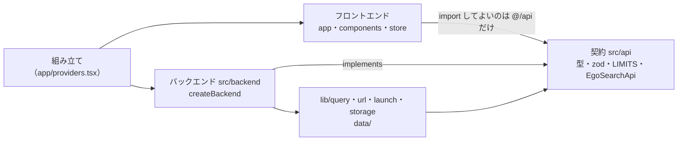

# API仕様書：フロントエンドとバックエンドのインターフェース

## 0. 前提
- **これは HTTP の API ではない。** アプリは静的書き出しのままで、サーバーを持たない。ここでいう「フロントエンド」と「バックエンド」は、**同じブラウザの中で動くコードの2つの層**である。層を分けるのは、画面を作り直しても規則・保存を触らずに済み、規則・保存先を差し替えても画面を触らずに済むようにするため。両者の境界（インターフェース）をこの文書で決める。
- 関連文書：`docs/requirements.md`（機能 F1〜F12、データ構造 11章、DAO 12章）、`docs/screen-spec.md`（S1〜S10、D1〜D3）、`docs/implementation-plan.md`（ファイル構成、AST）、`docs/research-phase0.md`（URL 形式の確度）。**意味と規則はそちらが正で、この文書には写さない。** ここには、境界をまたぐ関数の形・型・エラーの形だけを書く。
- 正にするもの：保存データの型と DAO は作成済みの `src/lib/storage`、検索文字列の規則は `src/app/mock/_parts/query-model.ts`（モックが正。要件定義書 10.4）。**既存のシグネチャは変えない**（変えるときは、先にこの文書を直す）。
- 各項目の状態の凡例：**作成済み**（コードがある）／**予定（#番号）**（Issue がある。書かれていない挙動は書かない）／**決定**（この文書で決めた）／**未決定**（7.3。推測で埋めない）。
- 用語：検索先は「X」「Yahoo!リアルタイム検索」。コード中の識別子 `'x'`・`'yahoo'` は、そのまま書く。複数の検索をまとめたものは「いつものエゴサ」。

## 1. 目的と境界

### 1.1 責務
| 層 | 置き場所 | 持つもの | 持たないもの |
|---|---|---|---|
| **フロントエンド** | `src/app/`、`src/components/`、`src/store/`（zustand）、`src/messages/`（辞書） | 画面、部品、画面の状態（入力中の検索語・開閉・ページ内の検索の組み立て）、文言（日英）、ブラウザの操作（`window.open`・クリップボード・`location`・`sessionStorage`・トースト・フォーカス） | 検索文字列の規則、URL の組み立て、保存、上限、連動、ID と日時の生成 |
| **バックエンド** | `src/backend/`（`createBackend`）と、その下の `src/lib/query`・`lib/url`・`lib/launch`・`lib/storage`・`src/data/` | 検索文字列の規則と組み立て（F2・F3・11.3・11.4）、X／Yahoo!リアルタイム検索の URL（F5）、ランチャーの codec（F8）、マスタ JSON、保存（DAO）、上限・連動・削除済み・プリセット、ID と日時 | 画面、文言、ブラウザの操作 |
| **契約** | `src/api/` | 型、zod スキーマ、`LIMITS`、`EgoSearchApi`（インターフェース）、エラーと警告のコード | 実装 |

- フロントエンドが `window.open` などを持つのは、ユーザーのクリックの中で同期に呼ぶ必要があるため（F8）。バックエンドは「どの URL を開くか」だけを返す。
- `src/lib/utils.ts`（shadcn の `cn`）と `src/lib/build-info.ts` は画面の道具で、フロントエンドに属する。

### 1.2 依存の向き

- **フロントエンドが import してよいのは `@/api` だけ**（`@/lib/utils`・`@/lib/build-info`・`@/components/ui` を除く）。`@/backend`・`@/lib/query`・`@/lib/url`・`@/lib/launch`・`@/lib/storage`・`@/data` の import は ESLint の `no-restricted-imports` で禁止する（設定は API 層の実装 Issue で入れる）。
- **`@/backend` を import してよいのは、組み立ての1か所（`src/app/providers.tsx`）だけ。** そこで `createBackend(...)` を呼び、React のコンテキストに入れる。画面は `useApi()`（`src/store/`）で受け取る。
- 契約はバックエンドの内部（`lib/*`）を import しない。エンティティの zod スキーマと `LIMITS` は**契約が持ち**、`lib/storage` がそれを import する（定義は1つ。**決定**）。保存の版（`SCHEMA_VERSION`）と移行（`migrate.ts`）は `lib/storage` に残す。
- テストでは、`createBackend({ kv: new MemoryAdapter(), clock: 固定の日時 })` を渡す。画面のテストは、同じ契約を満たす別の実装に差し替えてもよい。
- 状態：契約の型と `createBackend` は**予定（新しい Issue。7.2）**。

## 2. 共通の決まり

### 2.1 同期と非同期
| 種類 | 形 | 対象 | 理由 |
|---|---|---|---|
| 計算 | **同期の純粋関数**（保存に触れない） | `query`、`url`、`master` | `window.open` はクリックの処理の中で同期に呼ばないとブロックされる（F8）。クエリ表示は入力のたびに組み立てる |
| 保存を伴うもの | **async**（Promise） | `data`、`launcher` | 保存先を差し替えても呼び出し側を直さないため（要件定義書 12.3）。`CompressionStream` も非同期 |
- 計算の関数は、**必要なデータを引数で受け取る**（例：`query.build` は条件ボタンの一覧を受け取る）。保存を読みにいかない。
- 「今日」は**バックエンドの `clock` だけが決める**（同期の関数も引数で日付を受け取らず、`clock` を使う）。フロントエンドが日付を知る必要があるときは `api.clock` から読む。

### 2.2 失敗の返し方（**決定**）
- **失敗しうる同期の関数**は `Result<T>` を返す（画面がその場で分岐するため）。失敗しない同期の関数は値をそのまま返す。
- **async の関数**は、失敗したら `ApiError` を throw する。
```ts
type Issue = { code: IssueCode; params?: Record<string, string | number> };
type Result<T> = { ok: true; value: T } | { ok: false; error: Issue };

type ApiErrorCode =
  | "LIMIT"            // 上限（params: kind, limit）。LimitError を包む
  | "CORRUPT"          // 保存データが壊れている（params: key）。StorageCorruptError を包む。上書きしない
  | "NOT_FOUND"        // 指定の ID が無い
  | "INVALID"          // 検証に失敗（params: field）
  | "LAUNCHER_BROKEN"  // ランチャーのデータが読めない（画面仕様書 6章の表）
  | "LAUNCHER_VERSION";// 知らないバージョン
class ApiError extends Error { code: ApiErrorCode; params?: Record<string, string | number> }
```

### 2.3 文言を返さない（**決定**）
- 警告・エラーは**コードと値（`Issue`）**で返し、文言はフロントエンドの辞書（`src/messages/`）が出す。日英の両対応（MVP の必須）のため。
- `implementation-plan.md` 2章の `warnings.ts`「警告の型と文言」は、「警告の型とコード」に直す。
- 警告をどこに出すかは UI が決める（モーダルにしない。画面仕様書 3.8）。`serialize-*` は `{ text, warnings }` を返す、という CLAUDE.md の決まりはそのまま。

### 2.4 コード一覧（**決定**。`IssueCode`）
| 区分 | コード | params | 出す関数 |
|---|---|---|---|
| 警告 | `period.overridesDateChip` | `label` | `query.build` |
| 警告 | `yahoo.listUnsupported` | — | `query.build`、`url.plan` |
| 警告 | `yahoo.filterUnsupported` | — | 同上 |
| 警告 | `yahoo.accountExcludeUnsupported` | `op`（`-from:`／`-to:`／`-@`） | 同上 |
| 警告 | `query.tooLong` | `length`、`limit` | `query.build`、`url.plan` |
| 止める理由 | `query.empty` | — | `query.build`（`blockers`） |
| 止める理由 | `period.inverted` | — | `query.build`（`blockers`） |
| 失敗 | `url.unreadable`／`url.unsupportedHost`／`url.noQuery` | — | `url.parse`（画面仕様書 5.8 の3つの文言に対応） |
| 失敗 | `list.invalid` | — | `url.listId`（画面仕様書 D1） |
| 失敗 | `chip.labelRequired`／`chip.labelTooLong`／`chip.empty`／`chip.badNumber`／`chip.badDate` | `index`（行の位置） | `query.validateChip`（画面仕様書 D1 の保存しない理由） |
- 上限（`LIMITS.chips` など）を超えた追加・復元は、同期では判定せず、async の保存で `ApiError('LIMIT')` になる。画面は、押せない状態にするために `LIMITS` と件数を自分で比べてよい。
- Yahoo!リアルタイム検索で使えない演算子のうち、**上の3つに無いもの（解析できない演算子 `raw` など）の警告**は未決定（7.3、#15）。「黙って削除しない」（CLAUDE.md）は守る。

### 2.5 そのほか
- 日時は ISO 8601、日付は `YYYY-MM-DD`、ID は文字列（新規は UUID。プリセットから作る条件ボタンは `<興味の対象>:<key>`）。ID と日時はバックエンドが付ける（フロントエンドは作らない）。
- **ストアはルールを持たない。** 上限・連動・並び順・プリセット・削除済みの上限・名前の一致は、すべてバックエンドが行い、**変わったものを戻り値で返す**。ストアはそれを状態に反映するだけにする。
- 検索文字列は、**保存形（X の構文。相対期間は `since:yesterday` などの記号のまま）**が基準。Yahoo!リアルタイム検索用の変換は、開くとき（`url.plan`）だけで行う（F5）。

## 3. データの型（`src/api`）
- **エンティティ**（`Chip`・`Favorite`・`Group`・`GroupItem`・`HistoryItem`・`Prefs`・`TrashEntry`・`TrashKind`・`Engine`・`InterestId`）は、`src/lib/storage/schema.ts`（zod）の定義をそのまま契約へ移す（**作成済み**。移動は実装 Issue）。この文書には写さない。
- 以下は、**境界で使う型**。形はモックの `_parts/data.ts`・`query-model.ts` に合わせた（**予定**。#71・#12）。
```ts
type Period = { kind: "none" | "d1" | "d3" | "d7" | "date"; from: string; to: string };
type Tri = "any" | "inc" | "exc";
type Detail = {                        // 詳細条件。EMPTY_DETAIL は契約が出す
  exact: string[]; plain: string[]; variants: string[]; exclude: string[];
  from: string; to: string; mention: string; list: string;
  exFrom: string; exTo: string; exMention: string;   // -from: -to: -@
  flt: Record<FilterKey, Tri>; lang: string;
  minFaves: string; minRt: string; minReplies: string;
  live: boolean;                       // X の「最新」タブ（f=live）
  disabledConds: string[];             // `<ボタンID>::<トークン>`（disabledKey）
  raw: string;                         // 「テキストで追加」
};
type CondKind = "word" | "exact" | "exclude" | "list" | "account" | "filter" | "raw" | "number" | "date";
type Cond = { id: string; kind: CondKind; value: string; op?: ParamOp };

/** 検索の組み立ての状態（ホームもページ内の組み立ても同じ形。画面仕様書 3.1） */
type SearchState = {
  word: string; exact: boolean;
  onChipIds: string[];                 // ON の条件ボタンの ID（ホームは chip.on から作る）
  suggestionTokens: string[];          // この検索だけ ON にしたサジェスト
  detail: Detail; period: Period;
};
type BuiltQuery = {
  stored: string;                      // 保存形（お気に入り・いつものエゴサの本体）
  text: string;                        // 開く時点の文字列（記号を日付に展開済み。クエリ表示・コピー）
  warnings: Issue[];                   // 枠の下の警告欄に出す
  blockers: Issue[];                   // 保存・追加・開くを止める理由
  experimental: boolean;               // 実験的な演算子を含む（implementation-plan 4章）
};
type ParsedScope = {                   // query.parse の結果（お気に入りの編集・URL 解析のホームで編集）
  word: string; exact: boolean; onChipIds: string[]; detail: Detail; period: Period;
};
type PlanItem = { query: string; engine: Engine };            // = GroupItem
type OpenTarget = { engine: "x" | "yahoo"; url: string; query: string; warnings: Issue[] };
type RunPlan = { targets: OpenTarget[]; warnings: Issue[] };  // both は x・yahoo の2件。順番が開く順
type RunSource = HistoryItem["source"] & { favoriteId?: string };
type ParsedUrl = { engine: "x" | "yahoo"; query: string; tokens: { text: string; raw: boolean }[] };
type LauncherPayload = { name: string; items: PlanItem[] };   // zod スキーマも契約が持つ
type Interest = { id: InterestId; label: { ja: string; en: string }; list: { label: string; listId: string } | null };
```
- `ParamOp`・`FilterKey` は、**契約が持つ定数**（`PARAM_OP_TYPES: Record<ParamOp, "number" | "date">`、`FILTER_KEYS`）から導く。ラベル・接尾語などの文言は辞書が持つ。`operators.ts`（エンジン別の対応と `status`）は、この定数を import して、キーを1か所に揃える（**決定**）。
- `onChipIds` は、モックの `onIds` を改名したもの（モックは破棄予定）。
- `OpenTarget.query` は、開く時点の保存形（記号を日付に展開済み。X の構文）。履歴にはこれを残す（要件定義書 11.4「開く」。**決定**）。`url` だけが、検索先ごとの変換を受ける。

## 4. API 一覧（`EgoSearchApi`）
```ts
interface EgoSearchApi {
  master: MasterApi;     // 同期
  query: QueryApi;       // 同期・純粋
  url: UrlApi;           // 同期・純粋
  launcher: LauncherApi; // async
  data: DataApi;         // async（保存）
  clock: { today(): string; now(): string };   // YYYY-MM-DD／ISO 8601
  limits: typeof LIMITS;                        // 契約が持つ上限（lib/limits.ts は契約へ移す）
}
```

### 4.1 `master`（同期。**予定** #21）
| メソッド | 戻り値 | 説明 |
|---|---|---|
| `interests()` | `Map<InterestId, Interest>` | ヘッダーの切替。JSON に1件足すだけで増える（要件定義書 11.2） |
- 条件ボタンのプリセットとサジェストの規則は、**バックエンドの内部**に置く（画面は `data.chips.addPresets` と `query.suggest` を通して使う）。

### 4.2 `query`（同期・純粋。**予定** #71・#12〜#17。規則は要件定義書 F2・F3・F6・11.3・11.4）
| メソッド | 戻り値 | 備考 |
|---|---|---|
| `build(state: SearchState, chips: Chip[])` | `BuiltQuery` | 共通（ON かつ「表示」の条件ボタン、無効化した項目を除く）と個別の合成。期間を指定中は日付の条件ボタンを除いて警告。モックの `buildQuery` |
| `parse(stored: string, chips: Chip[])` | `ParsedScope` | 文字列 → 条件ボタンの ON・検索語・期間・詳細条件（11.4）。**内容は欠かさない**。モックの `parseToScope` |
| `expand(stored: string)` | `string` | 相対期間の記号を `clock` の日付に展開する（`expandRelative`）。詳細条件の「開くときは since:…」に使う |
| `periodTokens(p: Period)` | `string[]` | 期間 → 保存形のトークン（`periodToTokens`）。`until:` は終了日をそのまま出す |
| `tokenize(q)`／`normalize(q)` | `string[]`／`string` | 一致の判定は必ず `normalize` で行う（11.3） |
| `disabledKey(chipId, token)` | `string` | 項目ごとの無効化のキー |
| `chipConds(chip)`／`condsToQuery(conds)` | `Cond[]`／`string` | 条件ボタンの本体 ⇄ 条件の行（D1） |
| `validateChip(label: string, conds: Cond[])` | `Result<{ label: string; query: string }>` | D1 の保存前の検証。ラベルが空でも数値・日付の条件があれば演算子名をラベルにする（画面仕様書 D1）。上限は見ない |
| `favName(query, favorites)` | `string \| null` | いつものエゴサの項目の表示名（`favNameFor`） |
| `suggest(input: { text: string; chips: Chip[]; history: HistoryItem[] })` | `string[]` | 規則 → 履歴のトークンの順。条件ボタンにあるもの・検索に入っているものを除き、最大 `LIMITS.suggest`。履歴から取る条件の範囲は未決定（7.3、#80） |
- `applyFavEdit`（お気に入りの編集 → いつものエゴサ）は契約に出さない。`data.favorites.update` の中で使う。

### 4.3 `url`（同期・純粋。**予定** #18・#19）
| メソッド | 戻り値 | 備考 |
|---|---|---|
| `plan(items: PlanItem[], options?: { live?: boolean })` | `RunPlan` | 相対期間を展開 → 検索先ごとに URL を作る。`both` は2件。Yahoo!リアルタイム検索で使えない演算子と長さの警告（F5・F8）。URL 形式は5章 |
| `parse(input: string)` | `Result<ParsedUrl>` | X（`x.com`・`twitter.com`）と Yahoo!リアルタイム検索の URL → 保存形（F4）。解析できない演算子は `raw: true` のトークンとして保つ |
| `listId(input: string)` | `Result<string>` | リストの URL または数字 → ID（`parseListId`）。モックは null を返す |
- `options.live`：画面の「X の『最新』タブで開く」（`Detail.live`）。**お気に入り・いつものエゴサには保存しない**（スキーマに項目が無い。7.3）。

### 4.4 `launcher`（async。**予定** #20）
| メソッド | 戻り値 | エラー |
|---|---|---|
| `encode(payload: LauncherPayload)` | `{ hash: string; warnings: Issue[] }` | — |
| `decode(hash: string)` | `LauncherPayload` | `LAUNCHER_BROKEN`（ハッシュが無い・壊れている・スキーマに合わない）、`LAUNCHER_VERSION` |
- `hash` は `v1.<…>`（`#` を含まない）。**オリジン・パス（`/launch#`）を付けるのはフロントエンド**（`location` を知っているのはそちら）。
- 相対期間は記号のまま入れる。復号しても展開しない（開く時点で `url.plan` が展開する）。

### 4.5 `data`（async。保存を伴うユースケース）
DAO（`lib/storage`。**作成済み**）のメソッドを**そのまま見せず**、画面の操作の単位にする。上限・連動・順序・削除済みの上限はここで行い、変わったものを返す。
```ts
type AppData = {
  prefs: Prefs;
  chips: Map<InterestId, Chip[]>;     // 興味の対象ごと。非表示も含む。order 順
  favorites: Favorite[]; groups: Group[]; history: HistoryItem[];
};
interface DataApi {
  init(): Promise<AppData>;           // 初回はプリセットを入れる。CORRUPT のときは上書きしない
  chips: {
    save(input: ChipInput): Promise<Chip>;                      // 追加・更新。LIMIT
    setOn(id: string, on: boolean): Promise<Chip>;
    setVisible(id: string, visible: boolean): Promise<Chip>;
    setValue(id: string, condId: string, value: string): Promise<Chip>;   // 値付きの条件。query を書き換え、on にする
    reorder(interestId: InterestId, ids: string[]): Promise<void>;
    remove(id: string): Promise<void>;                          // 削除済みへ
    addPresets(interestId: InterestId): Promise<Chip[]>;        // 無いものだけ。上限まで。足したものを返す
    adoptSuggestion(interestId: InterestId, token: string): Promise<Chip>;   // LIMIT
  };
  favorites: {
    save(input: FavoriteInput): Promise<Favorite>;              // 新規
    update(id: string, patch: FavoritePatch): Promise<FavoriteUpdate>;
    duplicate(id: string): Promise<Favorite>;                   // 「<名前>（複製）」。いつものエゴサは更新しない
    reorder(ids: string[]): Promise<void>;
    remove(id: string): Promise<void>;                          // 連動しない
  };
  groups: {
    save(input: GroupInput): Promise<Group>;                    // 追加・更新。名前が空・項目が0件は INVALID
    remove(id: string): Promise<void>;
  };
  saveSearch(input: SaveSearchInput): Promise<{ favorite: Favorite; group: Group | null }>;
  history: {
    record(plan: RunPlan, source: RunSource): Promise<HistoryItem[]>;   // targets の数だけ。上限 LIMITS.history
    clear(): Promise<void>;
  };
  trash: {
    list(): Promise<TrashEntry[]>;                              // 新しい順
    detail(kind: TrashKind, id: string): Promise<TrashDetail>;  // 「中身を見る」
    restore(kind: TrashKind, id: string): Promise<void>;        // LIMIT（条件ボタンは戻す先の上限）
    purge(kind: TrashKind, id: string): Promise<void>;
    purgeKind(kind: TrashKind): Promise<void>;
    purgeAll(): Promise<void>;
  };
  prefs: { set(patch: Partial<Prefs>): Promise<Prefs> };
}
type FavoriteUpdate = {
  favorite: Favorite;
  groups: Group[];                    // 一緒に更新されたいつものエゴサ（変わったものだけ）
  count: number;                      // 更新した項目の数。0 ならトーストを出さない
  undo(): Promise<void>;              // お気に入りといつものエゴサを両方戻す
};
type SaveSearchInput = {              // ホームの［☆ 保存］（画面仕様書 3.7）
  favorite: FavoriteInput;
  target: { kind: "none" } | { kind: "group"; groupId: string } | { kind: "newGroup"; name: string };
};
type TrashDetail =
  | { kind: "chip"; chip: Chip } | { kind: "favorite"; favorite: Favorite } | { kind: "group"; group: Group };
```
- `ChipInput`・`FavoriteInput`・`FavoritePatch`・`GroupInput` は、対応するエンティティから `id`・`order`・日時を除いた入力（`id` があれば更新）。**予定**（実装 Issue で型を確定）。
- 対応する DAO：`chips`・`favorites`・`groups`・`history`・`trash`・`prefs`（**作成済み**。`src/lib/storage/types.ts`）。`data.*` は、これらを束ねて、上の規則（連動・上限・プリセット）を足す。
- `data.favorites.update`：編集前の文字列と正規化して一致するいつものエゴサの項目を更新する（11.4）。**`undo` は関数で返す**（同じブラウザの中で動く前提。リモートに移すときは見直す。7.3）。
- `history.record` の `source.favoriteId`：お気に入りの `lastRunAt` を更新するために使う。履歴には保存しない（参照しない）。

### 4.6 実行の順番（**決定**）
1. 通常：クリック → `url.plan(items)`（同期）→ **フロントエンドが `window.open`**（同じクリックの中）→ `data.history.record(plan, source)`（async。待たない）。
2. ブロックされたとき：開けた数と失敗数・個別リンクを画面の中に出す（F8）。履歴に何を残すか（開けたものだけか、実行した検索すべてか）は未決定（7.3 の8）。
3. S9 ランチャー：`launcher.decode` は async なので、**ページを開いたときに復号し、`url.plan` で `RunPlan` を作っておく**。クリックでは `window.open` だけを呼ぶ。ページを開いただけでは開かない。
4. 「リンクをコピー」：`url.plan` の `targets[].url` をコピーするだけで、履歴には残さない。

## 5. 外部の URL 形式
確度と根拠は `docs/research-phase0.md` 6章。ここには出力の形だけを書く。
| 検索先 | 形式 | 状態 |
|---|---|---|
| X | `https://x.com/search?q=<URLエンコードした検索文字列>`。「最新」は `&f=live`。期間は文字列の中の `since:`／`until:`（`until:` は指定日を含み、日本時間） | **予定**（#18） |
| Yahoo!リアルタイム検索 | `https://search.yahoo.co.jp/realtime/search?p=<変換後の検索文字列>`。期間は `since:`／`until:` を出さず、`lts`（開始日の0時）・`uts`（**終了日の翌日0時**）にする（UNIX 秒、ブラウザの現地時刻）。`ei=UTF-8` を付けるかは未決定。`rkf`・`ifr`・`utm_*` は付けない | **予定**（#15・#18） |
| ランチャー | `<オリジン>/launch#v1.<base64url(deflate-raw(JSON))>`。JSON は `LauncherPayload`（zod で検証）。`CompressionStream` が無いときは非圧縮の base64url にする（見分け方は未決定。7.3） | **予定**（#20） |
- Yahoo!リアルタイム検索への変換は F5 の表のとおり（OR の括りは `(A B)`、`from:` は `ID:`、`to:` は `@`、`list:`・`filter:`・アカウントの除外は警告して除く）。

## 6. 画面ごとの呼び出し
画面は `useApi()` で受け取った `EgoSearchApi` だけを呼ぶ。「フロント」は、ブラウザの操作と画面の状態。
| 画面 | 読む・計算する（同期） | 保存する（async） | フロントで行うこと |
|---|---|---|---|
| ヘッダー・メニュー | `master.interests` | `data.prefs.set({ interest, lang })` | 辞書の切替、メニューの開閉 |
| 帯（全ページ） | `url.plan` | `data.history.record`（source: group） | `window.open`、「今日は実行済み」を `history`・`clock.today()` から求める（定義は未決定。7.3） |
| フッター | — | `data.history.record`（再実行） | 最後の1件を `history` から表示 |
| **S1 ホーム** | `query.build`、`query.suggest`、`query.expand`、`url.plan` | `data.chips.setOn`／`setValue`、`data.saveSearch`（☆ 保存）、`data.history.record`（source: home）、`data.favorites`（［▶ 実行］は `url.plan`＋`record`）、`data.prefs.set({ favOpen })` | 入力中の検索語・詳細条件・期間の状態、`window.open`、クリップボード、保存シート |
| **S2 条件ボタン・D1** | `query.chipConds`／`condsToQuery`／`validateChip`、`url.listId`、`query.suggest` | `data.chips.save`／`setVisible`／`reorder`／`remove`／`addPresets`／`adoptSuggestion` | 並べ替えの操作、コピー（クリップボード） |
| **S3 お気に入り** | `url.plan` | `data.favorites.reorder`／`remove`、`record`（source: favorite、`favoriteId`） | 名前の絞り込み、`window.open` |
| **S3-E お気に入りの編集** | `query.parse`、`query.build`、`query.normalize`（関連するいつものエゴサの表示）、`url.plan` | `data.favorites.update`／`duplicate` | ページ内の検索の組み立ての状態、トーストの［元に戻す］（`undo`） |
| **S4 いつものエゴサ** | `url.plan`、`query.favName` | `data.groups.remove`、`launcher.encode`（D2）、`record`（source: group） | 一括の `window.open` とブロック時の表示、URL のコピー |
| **S4-E 追加・編集** | `query.build`、`query.favName`、`url.plan` | `data.groups.save`、`data.favorites.save`（② お気に入りに保存して追加） | ページ内の項目の並び（保存まで持つ）、検索の組み立ての状態 |
| **S5 履歴** | `url.plan` | `data.history.clear`（D3）、`data.favorites.save`（検索先は履歴の `engine` を引き継ぐ）、`record` | 一覧の表示、`window.open` |
| **S6 削除済み・D3** | — | `data.trash.list`／`detail`／`restore`／`purge`／`purgeKind`／`purgeAll` | 種類のタブ、確認ダイアログ |
| **S7 URL解析** | `url.parse`、`query.parse`（ホームで編集する） | `data.favorites.save`（検索先は貼った URL のもの） | 貼り付けの入力、ホームの状態への展開、`location` |
| **S9 ランチャー** | `url.plan`、`query.favName` | `launcher.decode`（ページを開いたとき）、`record`（source: launch） | `window.open`、ブロック時の表示、［ホームへ］ |
| S10 このサイトについて | — | — | 静的な文言だけ |
- 画面仕様書の S1〜S10・D1〜D3 の操作は、すべて上のどれかの呼び出しに対応させた。対応できない操作が見つかったときは、画面ではなく、この表と4章を直す。

## 7. 実装の状態

### 7.1 現状
| 部分 | 状態 | 備考 |
|---|---|---|
| DAO（`src/lib/storage`：`types.ts`・`schema.ts`・`kv-dao.ts`・`kv-adapter.ts`・`migrate.ts`） | **作成済み**（テストあり） | `data.*` の下位。`Dao.chips`・`favorites`・`groups`・`history`・`trash`・`prefs`。`get` は削除済みの行も返す（`trash.detail` に使える） |
| `LIMITS`（`src/lib/limits.ts`） | **作成済み** | 契約へ移す |
| 検索文字列の規則（`src/app/mock/_parts/query-model.ts`・テストあり） | モック | #71 で `lib/query/model.ts` へ。`query` の `tokenize`・`normalize`・`expand`・`parse`・`chipConds`・`condsToQuery`・`favName`・`suggest` の元 |
| AST・演算子・パーサー・シリアライザー・合成・期間 | 予定 | #12・#13・#14・#15・#16・#17（`query.build`・`url.plan` の下位） |
| URL の生成・解析・リスト ID | 予定 | #18・#19。モックの `parseListId` が元 |
| ランチャーの codec | 予定 | #20 |
| マスタ JSON と zod | 予定 | #21（プリセットとサジェストの中身は #70） |
| ストア ⇄ バックエンド | 予定 | #24（「ストア⇄DAO」から「ストア⇄API」へ直す） |
| 辞書（ja／en） | 予定 | #72（`Issue` のコードを辞書で文言にする） |
| **契約の型・`createBackend`・import の制限** | 予定（新しい Issue） | この文書の実装。7.2 |

### 7.2 実装の順（案。M1〜M4 に組み込む）
1. 契約：`src/api` に型・zod スキーマ・`LIMITS`・`EgoSearchApi`・`Issue` のコードを置く。`lib/storage/schema.ts` と `lib/limits.ts` の中身を契約へ移し、`lib/storage` から import する（既存のテストが通ること）。
2. `createBackend({ kv, clock })`：`query`・`url`・`master` は M1〜M3 でできたものから順に束ねる。`data` は DAO の上に作る。
3. ESLint の `no-restricted-imports`（1.2）と `src/app/providers.tsx`、`useApi()`。
4. ストア（zustand）は `useApi()` だけを使う（M4）。

### 7.3 未決定（推測で決めない。ユーザーか該当 Issue で決める）
| # | 項目 | 状況 |
|---|---|---|
| 1 | 条件ボタンの「新」印（`isNew`）の保存先 | モックにある（サジェストから追加すると付き、初めて押すと消える）が、`ChipSchema` に項目が無い。保存するならスキーマに足し、版を上げる |
| 2 | お気に入りの `lastRunAt` の使い道 | 要件定義書 11.2 にあるが、画面仕様書に表示が無い。いつものエゴサの実行でも更新するか。更新するなら `record` の `favoriteId` をどう渡すか |
| 3 | `Detail.live`（f=live）の保存 | お気に入り・いつものエゴサに保存する項目が無い。保存しないなら実行時は常に「最新」ではない |
| 4 | Yahoo!リアルタイム検索の URL → 保存形（X の構文）の変換 | `(A B)` は Yahoo!リアルタイム検索では OR、X では AND の括弧。逆変換の規則が文書に無い（#19） |
| 5 | Yahoo!リアルタイム検索で使えない `raw` トークンの警告 | コードを決めていない（#15） |
| 6 | 「今日は実行済み」の定義 | 履歴から求めるとあるが、項目の1つでも実行したか、すべてか。日付の境界（日本時間か端末の時刻か）も（#77・#78） |
| 7 | サジェストの履歴から取る「条件」の範囲 | 履歴の文字列のトークンのうち、検索語・期間をどう除くか（#80） |
| 8 | ブロックされたときの履歴 | 開けたものだけ残すか、実行した全部を残すか。4.6 は後者としたが、要確認 |
| 9 | ランチャー URL の長さの警告水準 | `LIMITS.urlWarn` は X のクエリ文字数。ブックマーク URL 全体にも使うのか（D2） |
| 10 | ランチャーの圧縮の有無の見分け方、`ei=UTF-8` の有無 | #20・#18 で決める |
| 11 | `CORRUPT`（保存データが壊れている）のときの画面 | 画面仕様書に無い。上書きしない決まりだけがある |
| 12 | `FavoriteUpdate.undo` が関数であること | 保存先を API に移すときは、スナップショットを返す形に直す |
