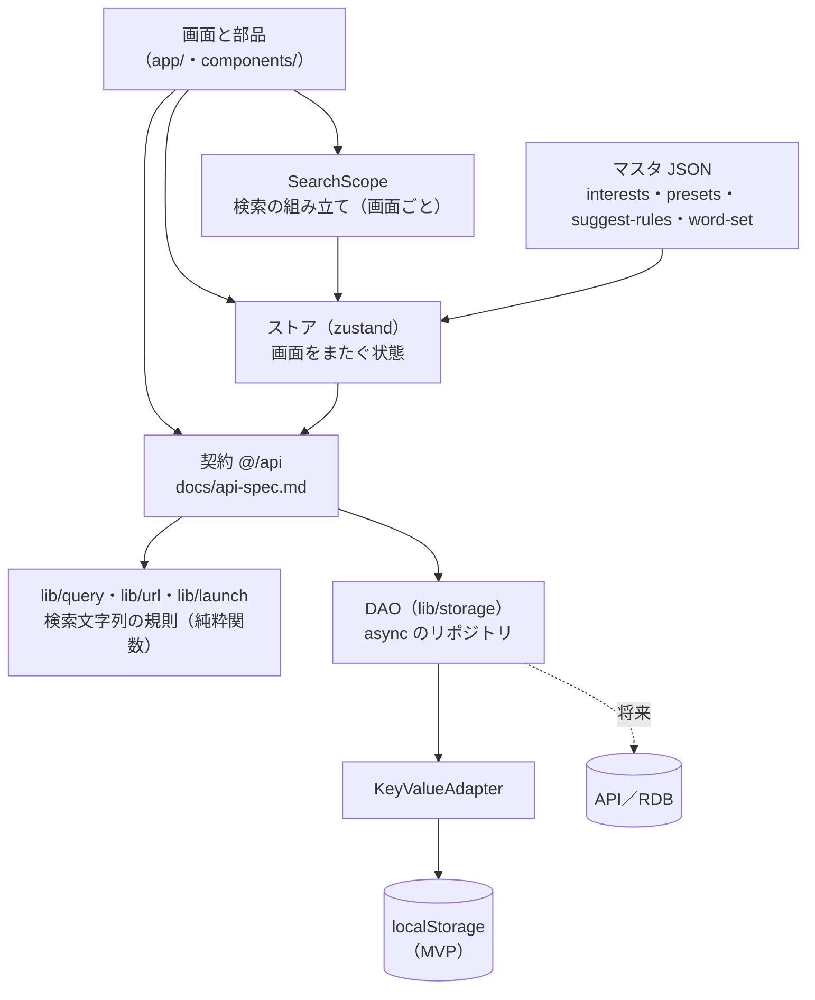
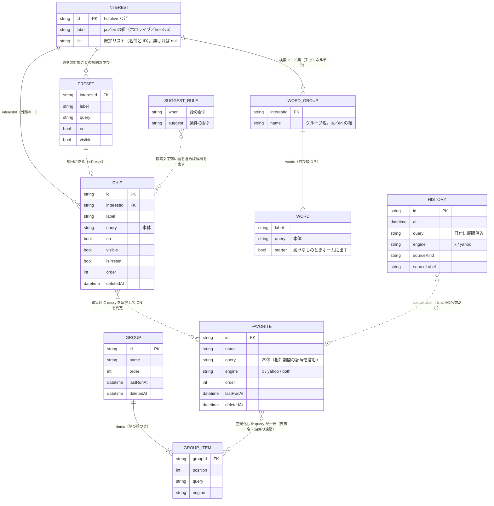
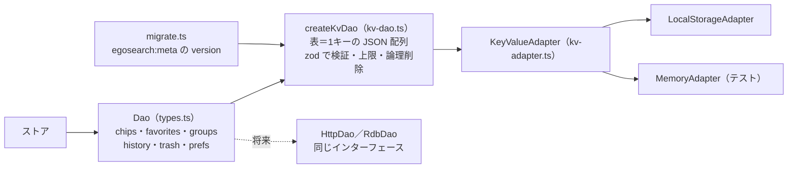

# 要件定義書：エゴサ支援Webアプリ（サイト名 Hololive EgoSearch）

> 2026-11-17 に mock1〜5 への感想を受けて全面改訂した（mock6 の方針）。同日の4巡目で mock6 を最終案として `/mock` に昇格した（mock1〜5 は削除）。旧番号（F1〜F9、S1〜S4、M1〜M3）との対応は付録Bにある。
> 同日の5巡目で、初回カードを廃止して「ホロライブ前提＋ヘッダーで興味の対象を切り替え」に変え（2026-11-20 に、切替をヘッダーから設定ページ S11 へ移し、試験的な機能とした）、サイト名を「EgoSearch Studio（仮称）」から「Hololive EgoSearch」に変えた（F11、9章）。
> 2026-11-18 に、**モック（`/mock`）を絶対の正**として全体を照合し直した。あわせて、①条件ボタン・お気に入り・いつものエゴサの本体をすべて検索文字列にし（相対期間も `since:yesterday` などの記号で文字列に入れる）、②興味の対象に「その他」を足して条件ボタンを興味の対象ごとの並びにし、③保存先を差し替えられる DAO を置いた。モックと同じアプリを作る方法を10章、データ構造とつながりを11章、DAO を12章、開発者が決めることを13章に書いた。（2026-11-20：モックは #61 で破棄した。今は、この文書と本実装が正で、食い違いを見つけたらユーザーに確認する。）
> **用語**：検索先の正式名は「Yahoo!リアルタイム検索」。画面の文言（警告・説明・選択肢）では正式名を使い、「Yahoo」と短く書いてよいのはボタン（［Yahoo で開く］）、［⋯］のメニュー項目、お気に入り・いつものエゴサの行の検索先バッジ（「X」「Yahoo」「X＋Yahoo」。ただの識別子）だけ。この文書の技術的な記述（変換規則・演算子・URL）の「Yahoo」は略記。

## 1. 目的
- X（Twitter）のエゴサを毎日手早く行えるよう、検索の「保存・修正・一括実行」に特化したツールを提供する。
- 画面上部に機能タイトル「X（Twitter）」を表示する。今後、YouTube 検索・TikTok 検索でも同様のエゴサツールを同じサイトに足す予定（予定のため Issue は作らない。機能ごとにタイトルで切り替える想定）。
- 主な対象はホロライブ・にじさんじのタレントとその周辺の人。**サイトを訪れる人はホロライブに興味があることを前提にする**（サイト名・説明・SEO はホロライブ向け。9章）。興味の対象（ホロライブ／にじさんじ）は、設定ページでいつでも切り替えられる（F11。試験的な機能）。
- **作った理由**：SNS の検索は毎日のことなのに、検索コマンドを覚えておく機能がなく、毎日いくつも検索するのに、その検索を保存してまとめて実行することもできなかった。その負担を減らすため、何度でも使える検索ボタン（条件ボタン）を用意し、毎日の調べ物のためにお気に入りといつものエゴサの機能を加えた。サイトの説明（ホームの冒頭と「このサイトについて」）はこの考えで書く。
- **基本方針：直感操作で作業でき、その延長で設定を保存できる。** 検索語を入れ、条件ボタンを押し、開く。気に入った組み合わせはそのまま保存する。複雑な設定は左メニューに集約し、ホームには検索の組み立てと実行だけを置く。**表示と編集は分ける**：ホームの部品は押すだけで、追加・編集・削除・並べ替えはメニューの専用ページで行う。日課の実行（いつものエゴサ。帯の［＋］から追加もできる）はヘッダー下の帯（全ページ・ランチャーを含む）、前回の履歴はフッターに固定する。お気に入りは検索エリアの下に閉じた1行で置き、開閉は localStorage に記憶する。

## 2. 利用者
| 利用者 | 主な用途 | 求められること |
|---|---|---|
| タレント本人 | 自分の名前・タグのエゴサ、配信後のエゴサ | ワンタップで実行できること。専門知識がなくても使えること |
| マネージャー・運営 | 複数の監視、複雑なクエリ | 条件を細かく指定できること。いつものエゴサで一括実行できること |
| ファン・切り抜き師 | 推しの話題を追う | 既定のリストやボタンをそのまま使えること |
| 開発者 | 自分用。既定リストの管理 | 既定リストの追加が簡単なこと |

UIは、ホーム（日課の実行と直感操作）と、左メニュー（複雑な設定を機能ごとのページに集約）の2段構えにする。スマホとPCの両方に対応する（スマホを基準に設計し、PCは広い画面向けに配置を変える）。

## 3. スコープ
### 対象内
- 検索クエリの作成・保存・編集・URLの生成
- 2つの検索エンジン（どちらも主要機能として扱う）
  - **X検索**（ブラウザでログイン済みのXで開く）
  - **Yahoo!リアルタイム検索**（ログインせずに使える。Xのレート制限時の回避先であり、ミュートの影響を受けない結果を確認する手段でもある）
- 複数の検索を複数タブで一括で開く（いつものエゴサ）
- 設定入りのURLをブックマークして、ランチャーとして使う
- 実行履歴

### 対象外
- X APIの利用、スクレイピング、検索結果のアプリ内表示・埋め込み（Xはiframeで表示できないため）
  → アプリの役割は「URLを組み立てて開く」ことだけ
- ログアウト状態でのX検索（Yahoo!リアルタイム検索で代替する）
- ユーザー認証、サーバー側DB（MVP の保存先は localStorage だけ。ただし保存先は DAO（12章）で差し替えられるようにし、ブラウザをまたいだ共有や RDB への移行に備える）
- メンバー情報・表記ゆれ辞書の管理（ホロライブなどの所属者はXのリストで扱う。F1）

## 4. 機能要件

### F1. 既定リスト（開発者が管理し、ユーザーは閲覧のみ）
- 事務所のメンバーは個別に管理せず、**Xのリスト**で扱う。メンバー情報、表記ゆれ辞書、メンバー選択ダイアログ、テンプレート生成は持たない。
- 開発者が、次の既定リストを、興味の対象（F11）の定義の JSON（`src/data/interests.json`）の中に持つ。興味の対象ごとのプリセット（13章）の1つとして、初回起動時に条件ボタンとして登録する（F6）。既定リストを持たない対象（その他）もある。

| 名前 | リストID | 出典 |
|---|---|---|
| ホロライブ | `1412278227767218179` | `https://x.com/i/lists/1412278227767218179` |
| にじさんじ | `1478366370727608323` | `https://x.com/i/lists/1478366370727608323` |

- 既定リストを増やすときは、JSON に1件足すだけで済む形にする。スキーマは zod で検証し、ビルド時に不正なデータを検出する。
- ユーザーは自分のリストを条件ボタンとして登録できる。`https://x.com/i/lists/<ID>` のURLまたは数字のIDを貼ると、IDを取り出す（F6）。
- ユーザーは既定リストの内容を変更できない（既定リストから作られた条件ボタンの編集・削除はできる）。
- 「コラボ相手で探す」は、相手の所属リストのボタン（例：「ホロメンから」）で代替する。
- ハンドルやリストIDを推測で埋めない。上の2件以外は、開発者が確認した値だけを入れる。

### F2. 検索条件モデル
1つの検索は、次の要素で構成する。

| 区分 | 内容 | 出力例 |
|---|---|---|
| 検索語 | ホームの入力欄。「完全一致」の切替で引用符の有無を選ぶ | `"ぺこら"` |
| 条件ボタン（共通） | ONにしたボタンの中身（F6） | `-filter:retweets list:123` |
| 個別設定 | 詳細条件（F3）で足した、その検索だけの条件 | `min_faves:100` |
| 期間 | since / until（日付）。相対指定は記号で持ち、開くときに日付にする | 保存 `since:yesterday` → 開く `since:2026-11-17` |
| 生トークン | 解析できなかった演算子をそのまま保持 | — |

- 条件の種類：完全一致の語、通常の語、表記ゆれの展開（複数の語をORで結ぶ）、除外（`-語`、`-from:`など）、アカウント条件（from: / to: / @ / list:）、フィルタ（リプライ・メディア・RTの有無、言語、min_faves など）。
- 結合方法（AND / OR）を選べる。グループは入れ子にできる。`(A OR B) AND C` のような木構造で持つ。
- **共通と個別の合成**：ONにした条件ボタンが「共通」、詳細条件が「個別」。個別の検索は共通を**継承したうえで項目を追加**し、詳細条件の中で共通の**特定の項目だけを無効化**できる（例：この検索では「ネタバレ除外」ボタンのうち語Bだけ使わない）。
- **日付の自動入力**：Xは日付の `since:`／`until:` で出力する（UNIX秒の `since_time:` は人が読めないため生成しない）。Yahooは `lts`／`uts`（UNIX秒）に変換する（公式の記載は無いが実機で動作を確認した。`docs/research-phase0.md` 6章）。期間は**［昨日から］［3日前から］［1週間前から］の3つ**と、**日付の直接指定（以降／以前／範囲）**だけにする（「今日」「N日前から」「前回実行時から」は置かない。押した状態をもう一度押すと解除）。`until:` は指定日を含み、日本時間で評価される（#49 の実機確認）ため、画面の「終了日を含む」の日付をそのまま `until:` に出力する（翌日へ変換しない）。**保存する検索文字列の `until:` も同じ日付**で、画面にもそのまま出す。Yahoo の `uts` だけは、終了日の翌日0時に変換する。**相対指定は記号で検索文字列に入れる**：［昨日から］＝`since:yesterday`、［3日前から］＝`since:3days_ago`、［1週間前から］＝`since:1week_ago`。条件ボタン・お気に入り・いつものエゴサ・ランチャーの URL は記号のまま持ち、**開く時点の日付で `since:YYYY-MM-DD` に展開する**（X／Yahoo!リアルタイム検索の URL、クエリのコピー、履歴には記号を出さない）。記号の定義は1か所（`REL_PERIODS`）に集める。

### F3. 詳細条件（個別設定）とテキストでの追加
- ホームの「詳細条件」（旧「詳細設定（この検索だけ）」）は開閉エリアで、**初期は閉じた状態**。その検索だけの個別設定を、可能な限り細かく指定できる。
  - 語：完全一致、通常、表記ゆれ展開、除外の語
  - アカウント：from / to / メンション / list、および除外（`-from:` `-to:` `-@`。X の実機で確認済み。リストの除外 `-list:` は X で検索がエラーになるため置かない。`docs/research-phase0.md` 6章 E6）
  - フィルタ：リプライ・RT・引用・メディア（画像・動画）・リンクの有無、認証済み、言語、`min_faves` / `min_retweets` / `min_replies`
  - 期間：指定なし／昨日から／3日前から／1週間前から／日付を直接指定（以降・以前・範囲）。ホームと同じコントローラーを置き、同じ状態を共有する
  - 検索先（X／Yahoo!リアルタイム検索）は詳細条件に置かず、開くときはボタンで、保存するときは保存画面で選ぶ（F7）。X の「最新」タブは設定にせず、X は常に「最新」で開く（F5）
  - 共通（条件ボタン）の項目ごとの無効化
- 設定のたびに、プレビューへ即時に反映する。
- **テキストで追加**（詳細条件の中の入力欄）：上の欄に無い条件を、検索文字列のまま足せる。解析できない演算子は生トークンとしてそのまま URL に出力する。条件を木構造のまま編集する画面（旧「高度な編集」の［構造］）は作らない（各欄と重複するため。内部の条件モデルが木構造であることは F2 のとおり）。
- 詳細条件で使った条件は、実行時に履歴へ残り、次回以降のサジェスト検索条件の候補になる（F6、F9）。

### F4. URL解析
- 左メニューの「URL解析」で、次のURLを貼り付けると、検索条件モデルに分解して取り込める。
  - X：`https://x.com/search?q=...`（twitter.com も可）
  - Yahoo：Yahoo!リアルタイム検索のURL
- 解析できない演算子は「生トークン」として保持し、URLに戻したときに内容が欠けないようにする（往復の保証）。
- **保存形は X の構文**。Yahoo!リアルタイム検索の URL は、次の逆変換で X の構文に戻す（F5 の変換の逆）：

| Yahoo!リアルタイム検索 | 保存形（X） |
|---|---|
| `(A B)`、`A OR B`（括弧なしの `OR` は、通常の語と混ざるとき OR を先に結ぶ。E9） | `(A OR B)` |
| `ID:x`、`id:x` | `from:x` |
| `@x` | `to:x` |
| `lts`（UNIX 秒） | `since:YYYY-MM-DD`（現地の日付） |
| `uts`（UNIX 秒） | `until:YYYY-MM-DD`（`uts` の日付の1日前＝終了日を含む。F2） |
| 上に無いもの | 生トークン |

  - `@x` は、X ではメンションの検索になる記号と同じ形。Yahoo!リアルタイム検索の URL から取り込むときは「宛先（`to:`）」として戻す。違う意味にしたいときは、取り込んだ後に直す。
- 解析した条件は、**新規のお気に入りとして**保存するか、［ホームで編集する］でホームの検索に入れて移動する（そのまま［X で開く］も押せる）。ホームに入れるときは、お気に入りの編集と同じ規則（11.4）で、今の興味の対象の条件ボタンの ON・検索語・期間・詳細条件に展開する。既存のデータは上書きしない。

### F5. 検索エンジンごとのURL生成
- 1つの検索条件から、X用とYahoo!リアルタイム検索用のURLを生成する。
- Yahoo!リアルタイム検索で使えない演算子は**黙って削除せず、警告を表示する**（例：「list: はYahoo!リアルタイム検索では使えません」）。
- **警告の表示方法**：ユーザーの操作を止めないため、警告にダイアログ（モーダル）は使わない。ホームの「条件」の枠の一番下の警告欄、プレビュー内の警告欄、お気に入りの行のアイコンなど、操作の邪魔にならない場所に出す。［Yahoo で開く］には印を付けない（Yahoo!リアルタイム検索を使わない人には関係しない警告もあるため）。パネルを勝手に開いたり、フォーカスを奪ったりしない。
- Yahooへの変換規則（`docs/research-phase0.md` 4章・6章に基づく）：
  - ORグループは `(A B)` に変換する（Xの `A OR B` とは構文が異なるため、変換器を分ける）。括弧は OR になるので、AND グループは括弧を外して平らにする。否定した OR は `-A -B` に直す。OR の中の AND と否定した AND `-(A B)` は書き方が無く実機でも確かめていないので、X の形のまま出して `yahoo.groupUnverified` で警告する（2026-11-18 決定）。期間は OR の中にあっても `lts`／`uts` へ移す。Yahooでも `A OR B` が働くことを実機で確認したが、公式の記載がある `(A B)` を使う。URL解析では `OR` も受け付ける。
  - 期間は `since:`／`until:` を出力せず、URLパラメータ `lts`（開始日の0時）／`uts`（終了日の翌日0時）に変換する。時刻はブラウザの現地時刻で計算する。
  - `list:`、`filter:` は警告して除外する。`from:` は `ID:`、`to:` は `@` に変換する。
  - 引用符付きの語はそのまま出力する。完全一致として働くことを実機で確認したので、警告は出さない。
  - アカウントの除外（`-from:` など）は警告し、Yahoo!リアルタイム検索のミュート機能を案内する。
  - メンション `@x` はそのまま出し、Yahoo!リアルタイム検索では宛先として扱われると警告する（`yahoo.mentionAsReply`）。`lang:` は警告して除く（`yahoo.langUnsupported`）。`min_faves:`／`min_retweets:`／`min_replies:` は警告して除く（`yahoo.minCountUnsupported`）。どちらも実機で効かないことを確認した（`docs/research-phase0.md` 6章 E8）。`since_time:`／`until_time:` の秒は、そのまま `lts`／`uts` に入れる（警告なし）。
  - 解析できない演算子（生トークン）は、そのまま URL に入れ、「使えるか確認できていません」と警告する（コード `yahoo.rawUnverified`。黙って削除しない）。
- **X は常に「最新」タブ（`f=live`）で開く。** 画面にも保存にも設定は持たない。X の検索欄にはタブを切り替える演算子が無い（`f=` は URL のパラメータ）ため、検索文字列にも入れない。今後変わりうるので、値は X の URL を作る1か所の定数にする。Yahoo!リアルタイム検索は並び順を URL で指定できないので、何もしない。
- Yahoo!リアルタイム検索の URL には `ei=UTF-8` を付ける（`rkf`・`ifr`・`utm_*` は付けない）。

### F6. 条件ボタン
ホームの検索語の下に並ぶ、押すだけで条件を足せるボタン。旧「共通設定」の後継で、全検索に共通の設定の役割を持つ。

- **構成**：ラベル（表示名）と中身を持つ。**中身の本体は検索文字列**で、複数の条件を含められる（例：「ネタバレ除外」＝`-ネタバレ語A -ネタバレ語B`、「ホロメンから」＝`list:1412278227767218179`）。中身の条件どうしは AND（語の並びは OR にもできる）。編集画面や値付きの入力欄では、文字列を条件の行に分けて表示し、保存で文字列に戻す。
- **興味の対象ごとの並び**：条件ボタンは興味の対象（F11）ごとに別の並びを持つ。設定で対象を切り替えると、ホームと条件ボタンのページの並びが切り替わる。保持数・プリセット・削除済みからの復元先も対象ごと。
- **操作**：タップで ON/OFF。ON は青の枠＋薄い塗り＋✓、OFF は灰色の枠＋○（色だけにしない）。**押しても大きさが変わらない**（アイコン枠・枠線・文字の太さを揃え、「新」バッジは重ねて置く）。ONのボタンの中身が、検索に合成される。ホームの条件ボタンは**押すだけ**で、［＋］・［×］・取っ手・長押しは置かない。
- **値付きの条件**：中身に数値（`min_faves`／`min_retweets`／`min_replies`。例：［ファボ [50] 件以上］）、日付（以降＝`since:`／以前＝`until:`、除外＝`-since:`。例：［日付 [2026-11-07] 以降］）、**ユーザー名**（`from:`・`-from:`・メンション `@`・`-@`。X のユーザー名の形＝英数字と `_` の15字まで、`@` は付けない）、**リストID**（`list:`。1以上の整数）を持つボタンは、**ボタンの中の入力欄で値を変えられる**。値を変えるとボタンは自動で ON になり、**変えた値はボタンに保存する**（次回もその値で出る。最初の値は作成時の値）。入力欄の幅は固定し、値の桁数で幅を変えない。不正な値（空、1未満、日付の形式違い、ユーザー名の形でないもの）は検索に入れない。プリセットの値付きボタンは、値が空の状態で入る（空のうちは検索に入らない）。**既定リスト（［ホロメンから］など）は値を変えないボタンなので、入力欄を出さない**。`-since:` は実機で確かめていない（X で効くかは未確認。Yahoo!リアルタイム検索では解析できず「確認できない条件」の警告になる）。`-list:` は X でエラーになるので無い。「以前」は `until:` に日付をそのまま出す（指定日を含む。F2）。対応する演算子は定数1か所（`VALUE_OPS`）に集める。
  - **期間との重なり**：［期間］（F2）を指定しているあいだは**期間を優先**する。日付の条件を持つボタンは無効の表示（⊘、薄い表示、入力不可。理由は `title` と読み上げで示す）にして、その日付を検索に入れず、「条件」の枠の一番下に警告を出す（モーダルにしない）。ON/OFF の状態は残し、期間を外すと元に戻る。
- **追加**：①メニューの「条件ボタン」ページから手動で作る（ホームには［＋］を置かない）。②**サジェスト検索条件**（下記）を［＋ 条件ボタンに追加］で取り込む。③初回起動時に、興味の対象ごとのプリセット（既定リスト F1 のボタンを含む。中身は開発者が決める。13章）が条件ボタンとして入る。条件ボタンのページの［プリセットを追加］で、今の対象のプリセットのうち無いものを足し直せる（「無い」は、正規化した検索文字列が一致する条件ボタン〔削除済みを除く〕がその対象に無いこと）。条件ボタンが勝手に増えないよう、履歴からの自動追加は行わない。
- **サジェスト検索条件**：①**規則**（今の検索文字列の**語**に、規則の語（例：タレントの呼び名）が一致すれば、関連する条件（例：その人のファンアートタグ・エゴサワード）を、**検索ワード集のボタン（表示名）**で出す。**規則は検索ワード集から自動で作る**〔13章〕。照合は語単位で、部分一致ではない。「Su」が「Suisei」に当たって別人のボタンが出ることはない。除外した語（`-語`）や演算子の値（`from:語`）は語に数えない。引用符の中・括弧の OR の中の語は数える。空白を含む語（`Tokino Sora`）は、連続した語として一致する。英字の大文字・小文字、全角・半角は区別しない）と、②直近の検索（履歴）の文字列のトークンのうち、**期間（`since:`／`until:`）だけを除き**、検索語も条件も、条件ボタンに無く、今の検索にも入っていないものを、この順で候補として出す。**［もっと開く］で開いた後だけ**ホームに最大**20件**（定数1か所）を、破線枠のボタンで表示する。押すと、この検索にだけ ON/OFF できる（条件ボタンと同じ大きさ）。条件ボタンのページにも一覧を出し、［＋ 条件ボタンに追加］で条件ボタンにできる。**サジェストの表示順は変えられない**（並べ替えの対象外）。
- **検索ワード集**（2026-11-18 追加。Issue #89）：サジェスト（履歴が頼り）が使えない初期の補強として、開発者が Excel で決めた**興味の対象ごとの**検索ボタン（数百件）を持つ（13章）。**チャンネル単位のグループ**に分け、グループ名と、1件ごとの**表示名**は**日本語と英語の両方**を持つ（画面の言語で出し分ける。検索文字列は言語で変わらない）。すべての対象に出す**共通のグループ**（「共通」／Common。フィルタや言語など、プリセットと同じ形の条件）を先頭に置く。同じ検索文字列が別のグループにあってもよい（ファンネーム・グループ名は複数のメンバーで同じ）。1件は表示名と検索文字列（本体）。押すと、サジェストと同じく**この検索にだけ** ON/OFF できる（条件ボタンと同じ大きさ・見た目。条件ボタン・お気に入り・履歴には保存しない。条件ボタンに追加する操作は MVP に無い）。
  - **ダイアログ（画面仕様書 D4）**：条件の枠の［検索ワード集］ボタンで開く。**履歴の有無にかかわらず開ける**。グループごとの見出しの下にボタンを並べ、名前やタグで絞り込める。ダイアログの下端にクエリ表示を出し、押した結果がプレビューに出る。［閉じる］・Esc で閉じ、押したボタンへフォーカスを戻す。勝手には開かない。
  - **履歴が0件のとき**：Excel で「ホームに出す」印を付けた件数のうち**先頭から約60件**（`wordSetStarter`、定数1か所）を、条件ボタンの続きに**区別なく**つなげてホームに出す（先頭8個の折りたたみに含め、超えた分は［もっと開く］に入る）。条件ボタンにあるものは除く。ON にしても消えない。**履歴が1件でもあれば**ホームには出さず、ダイアログだけで使う。履歴が0件のときは、サジェストにダミーを足さない。
- **編集**：メニューの「条件ボタン」ページだけで行う（ホームからは「ボタンを編集 →」のリンクで移動する）。ラベルと中身を編集でき、1つのボタンに複数の条件を足し引きできる。
- **並べ替え**：同ページでドラッグ＆ドロップ。キーボードでも移動できる。
- **削除**：同ページの各行の［×］で行う。削除すると「削除済み」（F10）へ移り、復元できる。
- **コピー**：同ページの各行の［コピー］で、そのボタンの条件の文字列をクリップボードにコピーする（トーストで知らせる。ボタンは増えない）。
- **表示**：同ページの各行の［表示］で、ホームに出す／隠す。隠したボタンはホームの並び・件数・クエリのどれにも入らない（削除はされない）。
- **保持数**：**興味の対象ごとに60件**（暫定。プリセットが約40件あるので、初回に全部入っても自分で足す余地を残す。今後変更の可能性が高いので定数1か所）。上限に達したら、手動追加・サジェストからの追加は「上限です。不要なボタンを削除してください」と表示する。
- **折りたたみ**：ホームでは「表示」にしたボタンのうち**先頭8個**（定数1か所）を出し、9個以上あるときは［もっと開く（+N）］で続きを隠す。開くと全件とサジェスト（履歴が0件のときは検索ワード集の続きも）を表示する。**開いた後の［閉じる］は置かない**（使われないため）。隠れているボタンは描画しないのでフォーカスも当たらない。「ボタンを編集 →」は、ボタンの並びの最後の行の右端に置く。
- **リストの登録**：リストのURLまたはIDを貼って、リスト条件のボタンを作れる（F1）。
- **保存済みとの関係**：お気に入り・いつものエゴサ（F7）は条件ボタンを参照せず、検索文字列を本体として持つ。**ボタンの中身を直しても、保存済みの検索には波及しない**（7章のリスク）。どのボタンが ON かは、お気に入りを編集するときに文字列から解析して求める（11.4）。

### F7. お気に入りといつものエゴサ
- **お気に入り**：1つの検索に名前を付けたもの。**本体は検索文字列（相対期間の記号を含む）＋検索先（X／Yahoo!リアルタイム検索／両方）**で、条件ボタンを参照しない。ホームの［☆ 保存］で、触っていた状態を文字列にして保存する。**編集は専用ページ**（画面仕様書 S3-E）で行い、開いたときに文字列を解析して、条件ボタンの ON・検索語・期間・詳細条件に展開する（11.4）。**検索先は、お気に入りを作る・直す画面（☆ 保存、お気に入りの編集、いつものエゴサの追加の②）で必ず選べるようにする**（初期値は X。URL解析・履歴から保存するときも `EnginePicker` で選ばせ、初期値は元の検索先）。［▶ 実行］といつものエゴサの一括実行は、この検索先で開く（両方なら2タブ）。**いつものエゴサの項目の検索先は、いつものエゴサの編集画面で項目ごとに変えられる（元のお気に入りは変わらない）。**複製・並べ替え・名前変更ができる（お気に入りの複製は残す）。旧「プリセット」の後継。
- **いつものエゴサ**：複数の検索をまとめたもの（例：「配信後エゴサ（3個）」「今日のエゴサ」）。**本体は項目（検索文字列＋検索先）の配列**で、項目は名前を持たない。どのお気に入りを含むかは、項目の文字列とお気に入りの文字列を正規化して比べて求め（11.3）、一致すればそのお気に入りの名前を表示する。**お気に入りを編集すると、編集前の文字列と一致する項目も一緒に更新する**（トーストで件数を知らせ、［元に戻す］で戻せる）。お気に入りを削除しても項目は消えない。旧「検索セット」「グループ」の後継。用語は画面・文書とも「いつものエゴサ」に統一する。**エゴサのタイミングはだいたい決まっている**ので、**ヘッダー下の帯に先頭2件を固定**し（ランチャーを含む全ページ。名前は「配信後エ…(3)」のように省略）、どのページからもワンタップで一括実行できる。3件目以降は「いつものエゴサ」ページから実行する。
- **追加の方法は2つ**（帯の［＋］、いつものエゴサのページの［＋ 追加］、ホームの［☆ 保存］から行える）：
  - ①**お気に入りから追加**：名前を付け、既存のお気に入りの［＋ 追加］で、その検索文字列と検索先を項目として入れる。
  - ②**条件を指定して新しく作る**：ホームと同じ検索の組み立て（検索語・完全一致・条件ボタンとサジェスト・期間・詳細条件）で検索を作って**お気に入りに保存**し、それをそのまま、いつものエゴサに登録する。**名前の入力は「いつものエゴサの名前」1つだけ**で、お気に入りの名前は「<いつものエゴサ名>：<検索語または1つ目のボタン名>」を自動で付ける（あとから直せる）。追加・編集は詳細条件まで使うので、**専用のページ**（画面仕様書 S4-E）で行う。**検索の組み立ては内部の状態と部品を共通にする**（ホームの状態には影響しない）。UI の置き場所（シート・ページ）を共通にするという意味ではない（実装時の注意。`docs/implementation-plan.md`）。
- **お気に入りの削除**：いつものエゴサの項目はお気に入りを参照せず検索文字列を持っているので、**連動して消えるものはなく、確認も出さない**。削除済みへ移し、トーストの［元に戻す］で戻せる（F10）。連動するのは「お気に入りの編集」だけ。
- いつものエゴサには「今日は実行済み／未実行」を表示する。**いつものエゴサの `lastRunAt`（最後に実行した日時）が、端末の現地時刻で今日かどうか**で決める（履歴やお気に入りは見ない）。ISO（UTC）の値は、現地の日付に直してから今日と比べる。いつものエゴサを一括実行したときに更新する（ランチャーは ID を持たないので更新しない）。
- お気に入りには `lastRunAt` を持ち、S3 の行に「前回 11/17 21:03」（未実行は「未実行」）と出す。お気に入りの［▶ 実行］、いつものエゴサの一括実行、ランチャーで開いた検索のうち、**開く前の検索文字列を正規化して比べて一致するお気に入りすべて**を更新する（検索先は見ない。関係は文字列から導く。11.4）。
- 条件ボタンの削除・変更は、保存済みのお気に入り・いつものエゴサに影響しない。**黙って内容が変わることはない。**

### F8. 一括実行とランチャー
- **一括実行（帯・いつものエゴサのページ）のあとは、結果を持ったままランチャーへ移る**。開けた検索と、ブロックされて開けなかった検索を引き継ぎ（保存はしない）、ランチャーで［次を開く］で続きを開ける（2026-11-20 決定）。
- いつものエゴサを、設定入りのURL（`/launch#<圧縮したJSON>`）として発行する。これをブックマークしておけば、どの端末でも同じ検索を実行できる。
- **タブは、ユーザーのクリックを起点にしてだけ開く。** ページを開いただけで `window.open` を呼ばない。ポップアップがブロックされたときは、［次を開く］（1タップ1件）と、個別に開けるリンク一覧を常に表示する。
- 日付の相対指定は、URL に記号（`since:yesterday` など）のまま入れ、実行した時点の日時で計算する。
- URL に入れるのは項目（検索文字列＋検索先）といつものエゴサの名前だけ。項目の名前は、開いた端末のお気に入りと一致すればその名前、無ければ文字列を表示する。
- 長さの警告は、各クエリの文字数で判定する（X のクエリは500文字＝`LIMITS.urlWarn`。定数1か所であとから変えられる。実際の上限は特定していない）。ブックマーク URL 全体の長さでは判定しない（根拠のある上限が無く、効く制限は各クエリの長さのため。2026-11-19 決定）。
- ブラウザに圧縮（`CompressionStream`）が無いときは、圧縮せずに作る。読むときの見分けは接頭辞で行う：`v1.`（圧縮あり）／`v1u.`（圧縮なし）。
- ランチャーの［ホームへ］はホームへ移動するだけで、何も保存しない（既存のデータを上書きしない）。

### F9. 履歴
- 実行のたびに、日時、開いた検索文字列（相対期間は日付に展開済み）、エンジン、実行元（ホーム／お気に入り／いつものエゴサ）を記録する。使った条件ボタンは記録せず、画面が検索文字列から導く（今の興味の対象の「表示」の条件ボタンに当てはめる。11.4）。
- 履歴から、①同じ検索の再実行、②お気に入りへの保存、③サジェスト検索条件の候補（F6）を行う（「今日は実行済み」は履歴ではなく、いつものエゴサの `lastRunAt` で決める。F7）。
- 一覧はメニューの「履歴」ページで見る。**ホームには一覧を置かず、最後の1件だけをフッターに固定表示する**（［再実行］付き）。履歴の行の操作は［再実行］と［☆ お気に入りに保存］だけ（「条件ボタンにする」は置かない。条件ボタンへはサジェストから追加する）。
- 保持数は**100件**（暫定。定数1か所）。超えたら古い順に消える。全件削除は ConfirmDialog を挟む。
- 履歴は常に記録する（記録の ON/OFF の設定は置かない）。
- ログ（警告・保存の成否）は、セッション内のみで、履歴とは別に扱う。

### F10. 削除済み（ゴミ箱）
- 条件ボタン、お気に入り、いつものエゴサの削除は、すべて「削除済み」へ移す。**復元できる**ので、削除時に確認モーダルは出さない（連動して消えるものも無い）。
- 保持数は**種類ごとに20件**（条件ボタン20、お気に入り20、いつものエゴサ20。暫定。定数1か所）。超えたら、その種類の古いものから完全削除する。
- 3種類は互いに独立しているので、それぞれ別々に復元できる。
- 「削除済み」ページは、種類（すべて／条件ボタン／お気に入り／いつものエゴサ）のタブで切り替え、各タブに件数（例：3/20）を出す。1件ずつ［中身を見る］［復元］［完全に削除］を選べ、種類ごと・全体の完全削除もできる。［完全に削除］と［すべて完全削除］は ConfirmDialog を挟む（元に戻せないため）。
- 復元先が上限（F6）に達しているときは、復元できない理由を表示する。条件ボタンは削除したときの興味の対象を覚えていて、その対象の並びに戻す（上限もその対象で判定する。削除済みの行に対象の名前を出す）。

### F11. 画面構成とレスポンシブ
- **ヘッダー**：［≡］、サイト名（「Hololive EgoSearch」。ホームへのリンク）、機能タイトル（「X（Twitter）」。将来 YouTube／TikTok を足すときの区別になる）。
- **興味の対象の切替（試験的な機能。2026-11-20 にヘッダーから設定ページ `/settings` へ移した）**：設定ページに「興味の対象」のラジオグループを置き、「試験的」と表示する（既定はホロライブ。［ホロライブ］［にじさんじ］［その他］から1つ選ぶ）。ヘッダーには置かない。機能は誰でも使える。**興味の対象は今後増える前提**で、定義（ID・表示名・既定リスト）を1か所の JSON に集め、実行時は ID をキーにした Map で扱う（1件足すだけで切替に並ぶ）。初回カードは作らず、設定からいつでも選べる。選ぶと**条件ボタンの並びが、その対象のもの（F6）に切り替わる**。お気に入り・いつものエゴサ・履歴・削除済みは対象によらず共通。選んだ内容は端末内（localStorage）にだけ保存し、**外部から何も取得しない**（履歴の取得などはしない）。静的 HTML は既定のホロライブで出す（SEO のため）。キーボードで操作でき、選択中は太字とラジオの印で示す。今どの対象かをヘッダーでは示さない（リスクは7章）。
- **いつものエゴサの帯**：ヘッダーの下に全ページ（ランチャーを含む）で固定表示。「いつものエゴサ」の文字の横に［＋］（追加。F7 の方法）、続けて先頭2件（F7）。いつものエゴサの一覧へのリンクは、幅に余裕があるときだけ出す。
- **フッター**：最後の履歴を1件だけ固定表示する（F9）。
- **ホーム**：1カラム。上から、サイトの短い説明（作った理由を1〜2文。「詳しく →」でメニューの「このサイトについて」へ）、**検索語の入力 → クエリ表示 → ［X で開く］［Yahoo で開く］［☆ 保存］［⋯］（リンク・クエリのコピー）を1かたまりに隣接**させ（入力欄で Enter を押すと X で開く。日本語入力の確定の Enter では開かない）、続けて**1つの枠「条件」**に完全一致（チェックボックス）・条件ボタン（先頭8個）・期間（セグメント。日付の入力行つき）・詳細条件（開閉）を入れ、最後にお気に入り（実行だけ）。［X で開く］は一番大事な操作なので塗りつぶしの青で最も目立たせ、［Yahoo で開く］は外枠のボタンで隣に置く。**詳細条件の末尾にも、同じ開くボタン群（同じ状態・同じ処理）を置く**。**押しても画面がガタつかない**ように、クエリ表示・期間の注記の高さを確保する（URL 長の警告は⚠アイコンに含め、空の行を作らない）。
- **初回カードは作らない**（5巡目で廃止）。大きな初回カードは、もともと興味のある人以外を遠ざける。「初回だけ」の出し方も分かりにくい。名前・タグから「推しエゴサ」を自動で作る機能も廃止した（代わりに、入力欄に入れて［☆ 保存］し、いつものエゴサの［＋］でまとめる）。
- **このサイトについて**（メニューのページ）：**このサイトを作った理由**（1章）を冒頭に置き、続けて使い方の3ステップ、できること、データの扱い（ログイン・API を使わない、保存先は端末内だけ、非公式のファンメイドであること）。
- **左メニュー**：ヘッダーの［≡］で開く。**画面の約70%の幅**で開き、全画面は覆わない（残りは半透明の幕で、押すと閉じる）。項目は縦に並べる。**編集を含む複雑な操作は、すべてここから開く機能ごとのページに集約する**（条件ボタン、お気に入り、いつものエゴサ、履歴、削除済み、URL解析、設定、このサイトについて、バージョン情報、コマンドパレット。設定は今は興味の対象（試験的）だけ。表示言語の切替はメニューの下部に置く）。ヘッダーや他の要素と重ならない。
- **PC（768px以上）**：スマホと同じ1カラムを中央に寄せる（タイル型にしない）。1280px以上は左メニューを常時表示のサイドバーにする。
- **コマンドパレット**（Ctrl/⌘+K、またはメニューの項目）：お気に入り・いつものエゴサの実行とページへの移動を、キーボードだけで行える。
- 分割ペイン、IDE風のレイアウトは持たない。
- 最小対応幅は 360px。

### F12. 永続化
- MVP の保存先は localStorage。キーにバージョン番号を付け、スキーマの移行処理を用意する。
- **保存先は今後変わる可能性が高い**（ブラウザを変えるとデータを使い回せない問題がある。RDB やクラウドへ移す可能性もある）。そのため、画面と状態管理は保存先を直接触らず、**DAO（データアクセスオブジェクト）を通して読み書きする**（12章）。保存先を変えるときは DAO の実装を差し替えるだけで済む形にする。
- 保存するもの：条件ボタン（興味の対象ごと。ON/OFF、表示、並び順を含む）、お気に入り、いつものエゴサ、履歴、削除済み、設定（興味の対象、表示言語、お気に入りの開閉）。
- 保存データは zod で検証する。壊れたデータは上書きせず、エラーとして扱う。
- **壊れたデータからの復旧**：復元はできない。全ページ共通の表示で「保存データを読み込めず、復元できません」と伝え、［データを初期化する］を出す。押すと確認ダイアログ（画面仕様書 D3）を出し、実行すると**保存データをすべて破棄**してプリセットから作り直す。これと、設定（S11）の［データをすべて初期化］（同じ確認ダイアログ・同じ処理。2026-11-20 追加）の2つだけが、データを完全削除する一括の経路で、どちらもユーザーの操作でだけ行う（「上書きしない」の例外）。

## 5. 非機能要件
- Next.js（App Router。現在 16.4.6）+ React 19（現在 19.3.1）+ TypeScript + Tailwind CSS 4 + shadcn/ui + zod 4。Vercelにデプロイする。技術の詳細と、モックと同じアプリを作る方法は10章。
- ほぼクライアントだけで動かす。サーバー側は静的配信のみ。
- `any` を使わない。クエリのパーサーと文字列への変換は単体テストを必須にする（往復テストを含む）。
- **UIは日本語と英語の両方に対応する（MVP の必須要件）。** 初期値はブラウザの言語（日本語以外は英語）、左メニューの言語切替で切り替える（言語は設定ページに移さない）。文言は画面のコードに直書きせず、言語ごとの辞書から出す。どちらの言語でも、ヘッダーの省略表示・条件ボタンの幅・フッターの1行表示が崩れないこと。検索クエリ（演算子）は言語によらず同じ。
- 個人情報やトークンは扱わない。
- すべての操作をキーボードで行えるようにする。色だけで状態を示さない。

## 6. MVPと将来対応
- **MVP**：F1〜F12（履歴を含む）、日付の自動入力、**UI の日本語・英語の両対応**（5章）
- **将来**：YouTube 検索・TikTok 検索の同様のエゴサツール（同じサイトに機能として追加。予定のみで Issue は作らない）、保存先の移行（ブラウザをまたいだ共有、RDB。DAO の実装を足す。12章）、JSONのエクスポート/インポート、お気に入りの共有URL、チェックリスト（実行履歴の拡張）、既定リストの追加（にじさんじ以外の事務所など）、ユーザーによる既定リストの拡張

## 7. リスク・制約
- **完全一致が初期で ON になった**（2026-11-20）。検索語の欄に打った演算子（`from:xxx` など）も引用符で囲まれ、演算子として働かない。演算子は詳細条件や条件ボタンで足すか、完全一致を外す。ホームは毎回、完全一致 ON・条件ボタンはすべて OFF から始まる（前回の状態は覚えない）。
- **履歴から足した項目は、期間が日付で固定される**（#91）。履歴は開いた時点の日付に展開済み（`since:2026-11-19`）で残るため、履歴からいつものエゴサ（S4-E）やお気に入りに足すと、［昨日から］のような相対期間が毎日動かず、固定の日付になる。履歴の［☆ お気に入りに保存］も同じ。2026-11-20 に「そのまま足す」と決めた。扱いは #91 で決める。
- **履歴から足すと、お気に入りが自動で増える**。同じ検索文字列（正規化）のお気に入りが無いときだけ新しく作る（検索先は見ない）。追加の途中で［キャンセル］しても、作ったお気に入りは残る。
- **興味の対象を設定の奥へ移した**ため、切替に気づきにくい。今どの対象かがヘッダーに出ない。試験的な機能なので、保存する項目や仕様が変わりうる（変えるときは `migrate.ts` が要る）。
- localStorageはブラウザのデータ削除で消える。MVPにはバックアップ機能がないため、データを失う可能性がある（ブックマークURLが事実上のバックアップになる）。
- 一括でタブを開けるかは、ブラウザしだいである。**iPhone の Safari と Windows 11 の Google Chrome では、1回の操作で1件しか開けなかった**（実機。2026-11-20。公式の記載は未確認で experimental）。**複数同時に開けるブラウザは、まだ特定できていない**（MDN は「1回の操作で開くウィンドウは1つ」を前提にしている。調査は `research-phase0.md` 6章 E10）。そのため、一括実行のあとは常にランチャーへ移り、残りを［次を開く］で1タップ1件ずつ開く（画面仕様書 2.2・6章）。ブラウザの種類は判定しない。案内の文言は、分かっているブラウザ名で書き、原因が分からないときだけ「ブラウザによっては」と書く。
- XとYahoo!リアルタイム検索の検索仕様は予告なく変わることがある。そのため演算子の定義は1か所にまとめ、変更に対応しやすくする。
- **既定リストはXの外部のデータに依存する。** リストの所有者が削除・非公開にしたり、メンバーを入れ替えたりすると、検索結果が変わる。ID が無効になったら、開発者が JSON を直す。
- 条件ボタンの上限（60件）。サジェストからの追加は手動のため勝手には増えない。上限に達したら追加できない理由を表示し、既存のボタンは消さない。
- お気に入り・いつものエゴサは検索文字列を本体として持つため、**条件ボタンを直しても保存済みの検索は変わらない**（例：ネタバレ語を条件ボタンに足しても、保存済みのお気に入りには入らない。使うお気に入りを個別に直す）。代わりに、削除の連動・参照切れが起きない。
- **お気に入りといつものエゴサの対応は、文字列の一致で決まる**（ID の参照ではない）。
  - 正規化（11.3）で並び順・重複・空白の違いは吸収する。ただし、意味が同じでも書き方が違う文字列（`from:a` と `from:A`、`(A OR B)` と `(B OR A)` など）は、別のものとして扱う。
  - いつものエゴサの項目を、お気に入りとは別に書き換えた場合、その項目はお気に入りとつながらなくなる（名前の代わりに文字列が表示され、お気に入りを編集しても更新されない）。
  - 同じ文字列のお気に入りが2つあるときは、並び順で先のものの名前を表示する。どちらを編集しても、一致する項目が更新される。
- **お気に入りの展開（11.4）は、今の興味の対象の条件ボタンに当てはめる。** そのため、同じお気に入りでも、対象を切り替えると ON になるボタンが変わる。当てはまらない条件は詳細条件に入るので、検索の中身は変わらない。
- **データは端末（ブラウザ）ごと。** localStorage はブラウザごとに別なので、PC とスマホ、Chrome と Edge では同じデータを使えない。MVP ではブックマークURL（F8）が実質的な受け渡し手段になる。将来は DAO の実装を足して解消する（12.4）。
- 次の挙動は公式の記載が無く、実機での確認だけを根拠に採用している。予告なく動かなくなる可能性がある（詳細と代替手段は `docs/research-phase0.md` 6章）。
  - Xの `list:` と `to:` の併用（動かなくなったら `from:` のOR展開に切り替える）
  - Yahooの `lts`／`uts` による期間指定（代替手段が無い。無効になったら「Yahoo!リアルタイム検索では期間指定が使えません」の警告に戻す）
  - Yahooの引用符による完全一致（無効になったら警告を復活させる）
  - 括弧なしの `OR` と通常の語が混ざるときは OR を先に結ぶ読み方（`A B OR C` ＝ A AND (B OR C)）。X・Yahoo!リアルタイム検索とも実機で確認した（E9）。変わったらパーサーの1か所（`parseOr`）を直す
- Xの `since:`／`until:` は日本時間で評価され、`until:` は指定日を含む（2026-11-16、#49 の実機確認。公式の記載は無い）。予告なく変わる可能性がある。
- クエリ長の実際の上限は不明。警告水準の500文字は暫定値。
- 上限値（条件ボタン＝興味の対象ごとに60、削除済み＝種類ごとに20、サジェスト20、履歴100、折りたたみ前の条件ボタン8個、履歴なしのときホームに出す検索ワード集60件）は、今後変更する可能性が高い。定数1か所に集め、画面の文言にも数字を直書きせず定数から出す。
- **公式と誤認されるリスク（サイト名に「Hololive」を入れたことによる）。** カバー社の二次創作ガイドラインは「公式と誤解・誤認されうるもの」を避けるよう求めている（<https://hololivepro.com/terms/>。サイト名・ツールの扱いに関する個別の条項は確認できなかった）。対策として、description・「このサイトについて」・フッターに「非公式（ファンメイド）」と明記し（title には入れない。9.3）、公式のロゴ・画像・タレント名の画像を使わない。指摘を受けたときはサイト名を変える（名前は定数1か所に集める）。
- SEO の検索数は推定値（9章）。特に X 系の語は、改名前のデータで過小評価されている可能性がある。順位や流入は保証しない。

## 8. 要調査（Phase 0 で確認するまで仕様として確定しない）
> 2026-11-15 に机上調査と実機確認を実施。結果と採用方針は `docs/research-phase0.md` 6章を参照。Xの `since:`／`until:` は #49 で確認済み（日本時間、`until:` は指定日を含む）。
1. Yahoo!リアルタイム検索のURL形式とクエリパラメータ（`p=` など）
2. Yahooで使える演算子：`ID:`、OR、除外の挙動、日付で絞り込めるか（過去の報道では「検索条件として期間を直接指定できない」とされている）
3. Xの `until:` の境界（含むか含まないか、UTCかどうか）と、時刻単位の指定（`since_time:` など）ができるか
4. Xのクエリ長の上限と、URL長の実用上の上限
5. `list:` と `to:` を組み合わせた検索が、現在のXで期待どおりに動くか

## 9. SEO（サイト名・title・description）
> 2026-11-17 に調べた。サイトを訪れる人はホロライブに興味があることを前提に、サイト名と文言を決める。

### 9.1 検索数の根拠
出典は aramakijake.jp の月間推定検索数（取得日 2026-11-17）。

- Yahoo の値は、どの語でも Google の値のちょうど1/4で、独立した根拠ではない。そのため **Google の値だけ**を載せる。
- 「x 検索」が月8件しかない。データが X への改名前で古いとみられ、**X 系の語は過小評価**されている。

| 語 | Google／月 | 読み方 |
|---|---:|---|
| hololive | 2,192,000 | 公式などを探す指名検索。このサイトが上位を取る語ではない |
| ホロライブ | 1,464,000 | 同上 |
| ツイッター 検索 | 108,000 | 広すぎる語 |
| twitter 検索コマンド | 11,840 | ツールを探す意図で最大の語 |
| エゴサ | 7,920 | 中規模。「エゴサとは」のような意味調べも含む |
| エゴサーチ | 4,320 | 「エゴサ」の約半分。略語の方が強い |
| ツイッター 検索コマンド | 2,320 | |
| ホロライブ ツイッター | 2,320 | |
| X 検索コマンド／検索コマンド | 704 | 過小評価の可能性あり |
| x 高度な検索 | 576 | |
| twitter エゴサ | 472 | |
| ツイッター エゴサ | 168 | |
| x エゴサ | 88 | |
| ホロライブ エゴサ／ホロライブ 検索／エゴサ ツール | データなし | 競合の少ないロングテール |

**結論**
- 「エゴサ」は中規模（約8千）で、「エゴサーチ」より強い。ツールを探す意図が最も強いのは「検索コマンド」（twitter と組み合わせて約1.2万）。そのため、**両方を title に入れる**。
- 「ホロライブ」単体で上位を取ることは狙わない。「ホロライブ＋エゴサ／検索コマンド」というロングテールを狙う。
- Hololive・X・Twitter の3語は必ず入れる（ユーザー決定）。

### 9.2 Google の指針（出典：[サイト名](https://developers.google.com/search/docs/appearance/site-names)、[タイトルリンク](https://developers.google.com/search/docs/appearance/title-link)）
- サイト名（WebSite の `name`）は短く、広く認知された名前にし、ホームページ内の表記を統一する。`alternateName` で別名を優先順に指定できる。構造化データは**ホームにだけ**置く。
- title は各ページに固有で、簡潔にする。同じ語句を何度も繰り返さない。重要な語を前に置き、全角30〜35字を目安に収める。トップは説明を足してよく、他のページは「ページ名｜サイト名」にする。

### 9.3 決定した文言
| 項目 | 内容 |
|---|---|
| サイト名（`name`／表示） | **Hololive EgoSearch** |
| 別名（`alternateName`） | `ホロライブ エゴサ`、`HoloEgoSearch` |
| ヘッダー | `[≡] Hololive EgoSearch  [X（Twitter）]`（F11） |
| title（ja、ホーム） | `ホロライブのエゴサ用 X（Twitter）検索コマンド保存｜Hololive EgoSearch` |
| description（ja） | `ホロライブの推しを X（Twitter）でエゴサする検索コマンドを保存して、毎日の検索をワンタップで開けます。Yahoo!リアルタイム検索にも対応。ログイン不要、ファンが作った非公式ツールです。` |
| title（en） | `Hololive EgoSearch – Save X (Twitter) search commands for hololive fans` |
| description（en） | `Save and reuse X (Twitter) search commands for your favorite hololive talents and open your daily searches in one tap. Also works with Yahoo! Realtime Search. No login. Unofficial fan-made tool.` |
| 下層ページの title | `<ページ名>｜Hololive EgoSearch`（ページごとに固有） |

- 実装（#75）：
  - 文言は辞書 `meta`（ja／en。`src/messages`）。サイト名・別名・本番 URL は `src/messages/site.ts` の1か所。静的 HTML は ja で、`src/app/layout.tsx` の `metadata`（title は `default`＋`template`）がそこから出す。
  - en の画面では、`SiteMeta`（`components/common`）が `document.title` と description を辞書で差し替える（ページを移るたびに Next が静的な ja を書き戻すので、head の変更を見て合わせ直す）。
  - 下層ページの title は「ページ名｜サイト名」。ページ名はメニューの名前で、**管理ページ（条件ボタン・お気に入り・いつものエゴサ）だけ「〇〇の管理」**（見出しは変えない）。
  - **検索に出すのはホームだけ**：既定を `noindex, follow` にし、ホームだけ `index, follow`。JSON-LD もホームにだけ置く。
  - JSON-LD の `url`（本番 URL）は**未定**で、`SITE_URL` が空のあいだは出さない（決まり次第、開発者が記入する。リリース前の Issue で管理）。
  - 非公式の表記は description・「このサイトについて」・フッターに置く（title には置かない。2026-11-19 決定）。
- 静的 HTML に出る場所に置く（クライアントの状態で隠さない）。サイト名と、興味の対象の既定（ホロライブ）は静的 HTML に含める。
- リポジトリ名（egosearchX）と配信 URL は変えない。

## 10. 実装方式
> 2026-11-18 追加。2026-11-20 に、役目を終えた画面モック（`/mock`）の記述を外した（#61）。画面と部品の構成、層の分け方、技術スタックをここにまとめる。

### 10.1 技術スタック
| 層 | 採用技術 | 実装上の決まり |
|---|---|---|
| フレームワーク | Next.js（App Router、`output: 'export'` の静的書き出し）＋ React 19 ＋ TypeScript（strict） | サーバー処理（API ルート・Server Actions）は使わない |
| 見た目 | Tailwind CSS 4 ＋ shadcn/ui（Button など）＋ lucide-react（アイコン）。ダークモード固定 | 色は `globals.css` のトークンに集め、ON の見た目は `toggleClass`（1か所）にする |
| 並べ替え | `@dnd-kit/react`（`useSortable`）＋ `@dnd-kit/helpers`（`move`） | 既定のセンサーでキーボード（Space で持ち上げ、矢印で移動）にも対応する |
| 状態管理 | zustand（画面をまたぐ状態） | zustand のストア。初期化時に DAO から読み、変更のたびに DAO へ書く（persist ミドルウェアは使わず、DAO を通す） |
| 検索の組み立て | `SearchScope`（コンテキスト）＋同じ部品 | ホームはストアの状態、編集ページはページの中だけの状態を渡す（ホームの ON/OFF・期間に影響しない） |
| 検索文字列の規則 | 純粋関数（`lib/query`） | `lib/query` に移し、AST（演算子の定義・X／Yahoo の変換器）と合わせる |
| 保存 | DAO（12章）＋ localStorage | `src/lib/storage`（作成済み。テストあり） |
| 検証 | zod 4 | 保存データ・マスタ JSON・ランチャー URL を検証 |
| URL 圧縮 | `CompressionStream('deflate-raw')` ＋ base64url | ランチャーの codec |
| テスト | Vitest ＋ Testing Library（jsdom） | 純粋関数・DAO・主要な部品 |

### 10.2 層の構成

- **フロントエンド（画面・ストア）とバックエンド（`lib/*`・DAO・マスタ）を分け、境界は契約（`src/api`）だけにする。** 関数の形・型・エラーは `docs/api-spec.md`。画面が import してよいのは `@/api` だけ。
- 画面は保存先を知らない。保存はストアが契約の `data` を呼び、バックエンドが DAO を呼ぶ。
- 検索文字列の解析・組み立て・比較は、すべて `lib/query` の純粋関数で行う（画面ごとに書かない）。画面へは契約の `query` を通して渡す。

### 10.3 画面と部品の対応
| 画面・部品 | 置き場所 |
|---|---|
| ヘッダー・左メニュー・いつものエゴサの帯・フッター | `app/(site)/layout.tsx`＋`components/common` |
| 興味の対象の切替 | `components/common`（定義は `data/interests.json`） |
| 検索語・クエリ表示・開くボタン・☆ 保存 | `components/search` |
| 「条件」の枠・条件ボタン・期間・詳細条件 | `components/search`（`SearchScope` から読む） |
| 検索ワード集のボタン・D4 ダイアログ | `components/dialogs` |
| ホーム | `app/(site)/page.tsx`・`components/home` |
| S2 条件ボタン・D1 編集シート | `app/(site)/buttons`・`components/chips` |
| S3 お気に入り・S3-E 編集ページ | `app/(site)/favorites`・`app/(site)/favorites/edit`・`components/favorites` |
| S4 いつものエゴサ・S4-E 追加と編集 | `app/(site)/groups`・`app/(site)/groups/edit`・`components/groups` |
| S5 履歴・S6 削除済み・S7 URL解析・S9 ランチャー・S10 このサイトについて | `app/(site)/` の同じ名前のパス（`history`・`trash`・`import`・`launch`・`about`）と `components/` の同じ名前のディレクトリ |

## 11. データ構造
> 2026-11-18 追加。**条件ボタン・お気に入り・いつものエゴサの本体は、すべて検索文字列。** 互いに ID で参照せず、関係は文字列から導く。保存の型（zod）は `src/api/entities.ts`。

### 11.1 全体のつながり
実線は保存しているつながり（外部キー・入れ子）、破線は保存せず検索文字列から導くつながり。

- **外部キーで結ぶのは2つだけ**：条件ボタン → 興味の対象、いつものエゴサ → 項目。
- **お気に入りと項目、条件ボタンとお気に入りは結ばない。** 片方を消しても、もう片方が壊れない（参照切れ・連動削除が起きない）。

### 11.2 エンティティ
共通：ID は文字列（新しく作るものは UUID。プリセットから作る条件ボタンも UUID）。日時は ISO 8601 の文字列。並び順は `order` 列（配列の順序に頼らない）。削除済みは `deletedAt`（null なら有効）。

**マスタ（開発者が JSON で持つ。ユーザーは変えない）**
| 名前 | 項目 | 説明 |
|---|---|---|
| Interest（興味の対象） | `id`、`label: { ja, en }`、`list: { label, listId } \| null` | ホロライブ／にじさんじ／その他。**ID をキーにした Map で扱う**（保存・JSON では ID をキーにしたオブジェクト）。1件足すだけで設定の切替と条件ボタンの並びが増える |
| Preset（プリセット） | `interest`（`common` か対象の ID）、`label: { ja, en }`、`query`、`on`、`visible` | 興味の対象ごとの、初回の条件ボタンの並び。JSON は **Excel と同じ1本の並び**で、各対象の並びは「`common` とその対象の行」を順に取り出したもの（共通の定義は1つ。対象を足すと共通が自動で付く）。既定リストは、並びに置いた目印の行 `{ defaultList: true }` の位置に、各対象の `list` から入れる（リストが無い対象は飛ばす）。キーは持たない（［プリセットを追加］の「無いもの」は検索文字列の一致で判定する。F6）。中身は13章 |
| SuggestRule（サジェストの規則） | `group`（確認用のグループ名）、`when: string[]`、`suggest: string[]` | 興味の対象の ID をキーにした Record の値（`suggest-rules.json`）。検索文字列の語に `when` のどれかが一致すれば（語単位）、`suggest`（その対象の検索ワード集の検索文字列）を出す。**検索ワード集から `npm run gen:master` が作る**（手で書かない）。中身は13章 |
| WordGroup（検索ワード集のグループ） | `name: { ja, en }`、`words: Word[]` | 興味の対象の ID か `common`（すべての対象に出す共通のグループ）をキーにした Record の値（`word-set.json`）。チャンネル単位のグループで、配列の順が表示順（共通のグループが先）。グループ名は日英の両方が必須、`words` は1件以上。中身は13章 |
| Word（検索ワード） | `label: { ja, en }`、`query`、`starter` | `query` が本体（空にしない）。`label` は言語ごとの表示名（日英とも必須）。`starter` は、履歴なしのときホームに出す印。同じ検索文字列が複数のグループ・対象内にあってよい。ユーザーは変えない |

**ユーザーのデータ（DAO で保存する）**
| 名前 | 項目 | 説明 |
|---|---|---|
| Chip（条件ボタン） | `id`、`interestId`、`label`（1〜20字）、`query`、`on`、`visible`、`isPreset`、`order`、日時 | 本体は `query`。興味の対象ごとに別の並び（上限60は対象ごと）。値付きの条件（`min_faves:50`、`since:2026-11-07`）は、ホームの入力欄で値を変えると `query` を書き換えて保存する |
| Favorite（お気に入り） | `id`、`name`、`query`、`engine`（`x`／`yahoo`／`both`）、`order`、`lastRunAt`、日時 | 本体は `query`（相対期間の記号を含む）＋`engine` |
| Group（いつものエゴサ） | `id`、`name`、`items: GroupItem[]`、`order`、`lastRunAt`、日時 | 項目の並び順＝開く順。`lastRunAt` は最後に一括実行した日時で、「今日は実行済み」の判定に使う（F7。スキーマの版2で追加。移行は既存を null にする） |
| GroupItem（項目） | `query`、`engine` | 名前を持たない。RDB では `group_items(group_id, position, query, engine)` |
| HistoryItem（履歴） | `id`、`at`、`query`（日付に展開済み）、`engine`（`x`／`yahoo`）、`source: { kind, label }` | 新しい順、上限100。両方で開いたときは2件 |
| Prefs（設定） | `interest`、`lang`（`ja`／`en`／`null`）、`favOpen` | 端末内だけ。`lang` の `null` は「選んでいない」＝ブラウザの言語に従う（初期値。ほかの設定を保存しても言語が日本語に固定されない） |
| 削除済み | Chip・Favorite・Group の `deletedAt` | 別の表を作らない（論理削除）。種類ごとに上限20、超えたら古い順に完全削除 |

### 11.3 検索文字列の規則（`lib/query/model.ts`）
- **分割（tokenize）**：空白で分ける。引用符の中（`"兎田 ぺこら"`）と括弧の中（`(A OR B)`。入れ子も可）では分けない。
- **正規化（normalize）**：分割して、重複を除き、並べ替え、空白1つでつなぐ。**保存データどうしの一致の判定は、必ずこの値で行う。** 引用符の有無は区別する（完全一致と通常の語は別の検索）。
- **相対期間の記号**：`since:yesterday`（昨日から）、`since:3days_ago`（3日前から）、`since:1week_ago`（1週間前から）。保存する文字列には記号のまま入れ、開く時点の日付で `since:YYYY-MM-DD` に展開する（expandRelative）。
- **日付の指定**：`since:YYYY-MM-DD`（その日以降）、`until:YYYY-MM-DD`（**その日を含む**。X と同じ意味、日本時間）。画面の「終了日（含む）」は、保存・表示とも同じ日付で、変換しない。
- **条件の行（Cond）**：条件ボタンの編集と値付きの入力欄では、文字列を1トークンずつ種類（語・完全一致・除外・リスト・アカウント・フィルタ・数値・日付・生）に分けて表示し、保存で文字列に戻す。値が不正な値付きの条件も演算子は残す（ボタンが値付きのまま）。
- **項目ごとの無効化**：詳細条件で共通（条件ボタン）の1項目を無効にするときは、`<ボタンID>::<トークン>` で項目を指す。

### 11.4 文字列から導く関係
| 場面 | 規則 |
|---|---|
| **お気に入りの編集・URL解析の［ホームで編集する］**（文字列 → 条件ボタンの ON・検索語・期間・詳細条件） | ①照合するのは、今の興味の対象の条件ボタンのうち「表示」のものだけ。②トークンの数が多いボタンから順に、全部のトークンが含まれていれば ON にし、使ったトークンは他のボタンに使わない。③値付きのボタンは値まで一致したときだけ ON（ボタンの値は書き換えない）。④残りは、期間の記号・日付 → 期間、先頭の語 → 検索語（引用符付きなら完全一致）、既知の演算子 → 詳細条件の各欄、それ以外（同じ欄の2つ目を含む）→「テキストで追加」。**内容は欠かさない**（展開して組み立て直すと、正規化した文字列が元と一致する。往復テストで保証） |
| **いつものエゴサの項目の表示名** | 正規化した `query` が一致するお気に入りのうち、並び順で先のものの名前。無ければ検索文字列 |
| **お気に入りの編集 → いつものエゴサ** | 編集前の `query` と正規化して一致する項目の `query` を、新しい文字列にする。項目の `engine` は、編集前のお気に入りと同じだったときだけ新しい検索先にする（項目ごとに選び直した検索先は残す）。トーストで件数を知らせ、［元に戻す］でお気に入りといつものエゴサを両方戻す。文字列も検索先も変わらなければ何もしない |
| **お気に入りの削除・複製** | 連動しない（項目は文字列を持っている） |
| **条件ボタンの編集・削除** | お気に入り・いつものエゴサには**波及しない**（7章のリスク） |
| **サジェスト** | 今の検索文字列（保存形）の語に SuggestRule の `when` のどれかが語単位で一致すれば `suggest` を出す（すでに検索に入っている条件と、条件ボタンにあるものは除く）。`suggest` が検索ワード集のワードなら、その表示名のボタン（`WordChip`）で出す。続けて履歴のトークン（期間 `since:`／`until:` だけを除く。検索語も含む）。合わせて最大20件 |
| **検索ワード集のホーム表示** | 履歴が0件のときだけ、今の興味の対象の `starter` の Word を、グループ順・Word の順に、条件ボタンのトークンに無いものを最大 `wordSetStarter`（60）件。ダイアログ（D4）は履歴によらず全件を出す。ON は検索ごとの状態（`suggestionTokens`）で、サジェストと同じ |
| **開く（実行）** | 保存した `query` の相対期間の記号を、その時点の日付に展開してから URL を作る。履歴にも展開後の文字列を残す。**展開前の文字列を正規化して一致するお気に入りすべての `lastRunAt` を更新し、いつものエゴサの実行ならそのいつものエゴサの `lastRunAt` も更新する**（F7） |

### 11.5 例：1件の検索の流れ
1. ホームで「メンバーA」（完全一致）を入れ、［RTを除く］［ネタバレ除外］を ON、期間［昨日から］にして［☆ 保存］（検索先 X）。
2. 保存されるお気に入り：`{ name: "名前エゴサ", query: "\"メンバーA\" -filter:retweets -ネタバレ語A -ネタバレ語B since:yesterday", engine: "x" }`。
3. いつものエゴサ「今日のエゴサ」に①で追加 → 項目 `{ query: 同じ文字列, engine: "x" }`。表示名は、文字列が一致するので「名前エゴサ」。
4. 2026-11-18 に一括実行 → `since:yesterday` を `since:2026-11-17` に展開して X を開き、履歴に展開後の文字列を残す。
5. お気に入りを編集（S3-E）→ 文字列を展開し、［RTを除く］［ネタバレ除外］が ON、期間［昨日から］、検索語「メンバーA」の状態で開く。［画像つき］を足して保存 → お気に入りの `query` に `filter:images` が入り、「今日のエゴサ」の項目も同じ文字列に更新される（トースト「いつものエゴサの1件の項目も更新しました」）。
6. 条件ボタン［ネタバレ除外］に語Cを足す → お気に入り・いつものエゴサは変わらない。

### 11.6 項目と画面の対応
| 項目 | 入力する画面 | 使う場所 |
|---|---|---|
| Chip.query・label | S2 の D1、S2 のサジェストの追加、ホームの値付きの入力欄（値だけ） | ホームの条件ボタン、お気に入りの展開 |
| Chip.on | （画面からは書かない。2026-11-20 に、条件ボタンの ON をホームの状態 `home.onChipIds` へ移した。ホームは毎回すべて OFF から始まる） | 画面は読まない（項目は残す） |
| Chip.visible | S2 の［表示］ | ホームの並び・展開の対象 |
| Favorite.query | ホームの［☆ 保存］、S3-E、S4-E の「条件を指定して新しく作る」と履歴からの追加、URL解析、履歴の［☆ お気に入りに保存］ | 実行、S3-E の展開、いつものエゴサの表示名・連動 |
| Favorite.engine | ［☆ 保存］・S3-E・S4-E の②の `EnginePicker`（URL解析・履歴の保存シートも同じ部品。初期値は元の検索先） | ［▶ 実行］、いつものエゴサの項目の初期値 |
| GroupItem | S4-E（①②）、［☆ 保存］の「いつものエゴサに追加」、S3-E の保存（連動） | 一括実行、ランチャー URL |
| Word.label・query・starter、WordGroup.ja・en | 入力する画面は無い（開発者が Excel → `npm run gen:master` → JSON） | D4 ダイアログ、履歴0件のときのホームの条件ボタンの続き |
| Prefs.interest | 設定ページ（S11）の「興味の対象」 | 条件ボタンの並び、展開の対象、プリセットの追加、検索ワード集の対象 |

## 12. データアクセス（DAO）
> 2026-11-18 追加。実装は `src/lib/storage`（テスト：`dao.test.ts`）。

### 12.1 目的
- 保存先は今は localStorage だが、**ブラウザをまたいだ共有や RDB への移行を見込んで、差し替えられるようにする。**
- 画面とストアは契約（`docs/api-spec.md`）だけを使う。DAO を呼ぶのはバックエンドだけで、保存先の違い（同期／非同期、キー／表、JSON／行）は DAO の中に閉じる。

### 12.2 層

### 12.3 インターフェース（要点）
> DAO はバックエンドの内部。画面・ストアとの境界（ユースケースの単位の `data`）は `docs/api-spec.md` 4.5 が正。以下は DAO 自身の要点。
- **すべて async**（Promise を返す）。localStorage は同期だが、RDB やリモートに移したときに呼び出し側を直さないため。
- `chips`：`listByInterest(interestId)`、`listAllByInterest()`（**`Map<興味の対象, Chip[]>`**）、`get`、`save`（追加・更新。新規で対象の上限に達していれば `LimitError`）、`softDelete`、`reorder(interestId, ids)`。
- `favorites`／`groups`：`list`、`get`、`save`、`softDelete`、`reorder(ids)`。`save` の `order` を省略すると末尾に付く。
- `history`：`list`（新しい順）、`add`（上限を超えたら古いものから消す）、`clear`。
- `trash`：`list`（3種類、新しい順）、`restore`（元の位置に戻す。条件ボタンは戻す先の対象の上限で判定）、`purge`、`purgeKind`、`purgeAll`。
- `prefs`：`get`（既定値つき）、`set(一部)`。
- 一覧は削除済みを含まず `order` 順。書く前に zod で検証し、不正なデータは保存しない。読んだデータが壊れていたら `StorageCorruptError` にし、**上書きしない**。

### 12.4 保存先の差し替えと移行
| 段階 | 保存先 | すること |
|---|---|---|
| MVP | localStorage（`LocalStorageAdapter`） | キーは `egosearch:v<版>:<表>`（chips／favorites／groups／history／prefs）と `egosearch:meta`（版） |
| スキーマを変える | 同じ | `SCHEMA_VERSION` を上げ、`migrate.ts` に移行処理を1件足す（キーに版が入るので、変えない表も新しい版のキーへ運ぶ）。新しい版で保存されたデータは古いアプリでは開かない |
| 編集の［元に戻す］ | （MVP）API が「戻す関数」を返す | 保存先をサーバーへ移すときは、関数を返せないので、編集前の値を返す形に直す |
| 端末内で容量を増やす | IndexedDB など | `KeyValueAdapter` を1つ実装するだけ（DAO はそのまま） |
| ブラウザをまたいで共有・RDB | API ＋ RDB（または BaaS） | `Dao` を API 向けに実装して差し替える。静的書き出しのままでは API を持てないので、**外部の API／BaaS とユーザー認証が必要**（3章の対象外を見直す。CLAUDE.md の「サーバー側の処理を足さない」も同時に見直す）。表は11.1のとおり（`interests`、`chips`、`favorites`、`groups`、`group_items`、`history`、`prefs`）。端末の localStorage から読み出して API に送る移行を1回だけ行う |

- RDB に載せやすいよう、最初から ID は文字列（UUID）、日時は ISO 形式、並び順は `order` 列、削除済みは `deletedAt` にしてある。互いを参照しないので、外部キーは「条件ボタン → 興味の対象」と「項目 → いつものエゴサ」だけ。

## 13. 開発者が決めること
> 2026-11-18 追加、2026-11-21 改訂（Issue #102）。値は推測で埋めず、確認したものだけを入れる。作業は Issue #70（[データ整備] 条件ボタンのプリセットとサジェスト規則の作成）と #102（[仕様変更] Excel から JSON を作る生成プログラム）。**Excel（`docs/data/presets-and-suggest-rules.xlsx`）が正で、JSON は `npm run gen:master`（`scripts/gen-master.mjs`）が作る**（手で JSON を直さない）。

| 決めること | 置き場所（予定） | 仮の値（モックで使っていたもの。モックは #61 で削除済みで、git の履歴にだけ残る） |
|---|---|---|
| 興味の対象の一覧（ID・表示名（ja／en）・既定リスト） | `src/data/interests.json` | ホロライブ／hololive（既定リスト `1412278227767218179`）、にじさんじ／NIJISANJI（`1478366370727608323`）、その他／Others（リストなし）。英語の画面では英語表記を出す |
| 条件ボタンのプリセット（対象ごと） | `src/data/presets.json`（Excel のシート「プリセット」） | 共通（フィルタ・言語・値付きのボタン）と、対象別（ホロライブの 3Dライブ・生誕祭など）。既定リストは先頭。ラベルは日本語・英語の両方（英語は「英語対応表」から）。値付きのボタン（`@`・`from:`・`list:`・`-@`・`-from:`・`-since:`）は、値が空の初期値で入る（Excel では `[XXX]`） |
| 検索ワード集（対象ごと。チャンネル単位のグループ） | `src/data/word-set.json`（Excel のシート「ワード集グループ」「検索ワード集」） | 共通のグループ（フィルタ・言語など）と、ホロライブのメンバー別グループ（77件）。ホームに出す印は Excel の「ホームに出す」。語の表示名は日英の両方（英語は「英語対応表」から） |
| サジェストの規則 | `src/data/suggest-rules.json`（検索ワード集から自動で作る） | グループごとに、呼び名の一覧（`("A" OR "B"…)` だけの検索文字列）の語が「対象の語」、グループの全ワードが「出す条件」。中身の確認は `npm run gen:suggest-review` が作る `docs/data/suggest-rules-review.xlsx` で行う |

- 例：「検索条件に『ときのそら』『そらちゃん』が含まれていれば、そのグループのエゴサワード・ファンアートタグ・推しマなどをサジェストに出す」。実在のタグ・ワード・ハンドルはユーザーが確認して入れる。
- 値付きの条件ボタン（min_faves など）のラベルは、Excel では画面と同じ形（`ファボ [50]件以上`、`日付 [2026-11-07] 以降`、`日付 [2026-11-14] 以前`）で書く。JSON に移すときは `[` より前（`ファボ`、`日付`）をラベルとして読み、`[ ]` の値と単位が検索文字列と合うかを照合する。
- **Excel のシート**：「興味の対象」「プリセット」「ワード集グループ」「検索ワード集」「英語対応表」（サジェスト規則のシートは無い。規則は検索ワード集から作るため）。グループは日本語で入力し、英語名は「ワード集グループ」の英語列に書く。ワードはグループを日本語名で選び、表示名・検索文字列・「ホームに出す」を書く。「共通」を対象にした行は、共通のグループ（「共通」）になる。タグ・名前の検索文字列は言語で変わらない。実在のタグ・名前はユーザーが確認した値だけを入れる。
- **英語対応表**（シート「英語対応表」：日本語／英語／メモ）：画面の言語が英語のときの、プリセットのラベル・検索ワードの表示名・既定リストの名前の英訳。「名前 [値] 単位」の形は名前と単位を別々に、「表示名(種類)」の形は表示名と種類を別々に引く。グループ名は「ワード集グループ」の英語列から引く。タグ（`#…`）・絵文字・英字だけの語は引かずそのまま。英語が空・表に無い日本語は、日本語のまま出る。足りない日本語は `npm run gen:master -- --sync-dict` が空の行で足す。プリセットのラベルは、**ボタンを足す時の言語**で保存する（あとで言語を切り替えても、保存したボタンは変わらない）。
- **生成プログラムの規則**：確認済みの〇の行だけを移す（「興味の対象」は〇を見ない）。値付きのラベル（`名前 [値] 単位`）は `[` より前をラベルにし、値と単位が検索文字列と合うか照合して、違えば止める。`[XXX]` は値が空の初期値（検索文字列は `from:` のように演算子だけ）。検索ワード集で、検索文字列が「-」の行と、値の入力欄が要る行（`[XXX]`）は入れずに報告する。ラベルは日本語・英語とも20字まで（超えると止める）。区切りの「 / 」・OR の前後の空白が無い検索文字列は、直さず入れて「要確認」に出す。
- JSON は zod で検証し、不正な値はビルドで検出する。検索ワード集は、グループ名とワードの表示名の日英が空でないこと、各グループに1件以上あることを検証する（同じ `query` の重複は許す）。プリセットは、対象の実在・既定リストの目印が1つまで・ラベル（日英）1〜20字・対象ごとの `query` の重複なしを検証する。サジェスト規則は、対象の実在と `when`・`suggest` が1件以上あることを検証する。**ホームに出す印（`starter`）の件数は検証しない**（少なければある分だけ、多ければ表示側が `wordSetStarter` 件で切る）。検証は `src/data/schema.ts`、実行は `prebuild`（`vitest run src/data`）。

## 付録A：要件と出典の対応
- 複数キーワード・手軽な修正 → F2, F3, F6, F7
- ログイン/ログアウトの区別 → 回答：「Yahooでできるならログアウト検索は不要」→ F5、対象外
- ブックマーク・複数タブ → F8（回答：設定入りURL）
- Yahoo!リアルタイム検索 → F4, F5
- 同じ箱からのリプライ・リスト検索 → F1, F6（リストをボタン化）
- 完全一致・あいまい・除外を複数指定、共通/個別設定 → F2, F6（回答：継承＋項目ごとに無効化、あいまいは2種類の両方）
- URL解析・部分修正・複雑な式 → F3, F4
- ホロライブ・にじさんじ、今後の拡張 → F1（回答：メンバー管理は廃止し、リストIDで扱う）
- 日常的な利用への特化 → F2 日付の自動入力、F7 いつものエゴサ、F9 履歴

### mock1〜5 への感想と要件の対応（2026-11-17）
| 感想 | 反映先 |
|---|---|
| mock2：開閉はメニューだけ、70%、メニューは縦、ヘッダーと重ならない、スマホとPC両対応 | F11 |
| mock2：トップはシンプルに、よく使う機能と日課の簡単実行に絞る | F7（グループをホーム最上段）、F11 |
| mock3：条件をボタンで足す、削除ボタン、履歴 | F6, F9, F10 |
| mock4（mock2の意図に近い）：メニュー機能が必要、タイル配置、パレット | F11 |
| mock5：ボタンに複数の意味、ネタバレ禁止語の編集、配信後エゴサを開く（3個） | F6, F7 |
| mock5：コラボ相手はメンバーではなくリストで | F1, F6 |
| mock6：条件ボタンは共通設定の役割、履歴から自動追加、不要は削除、削除済みから復元／完全削除（20件） | F6, F9, F10 |
| mock6：ボタン保持30件、ドラッグ移動、3行以上は「もっと開く」 | F6 |
| mock6：詳細設定は個別設定の開閉エリア（初期は閉じる） | F3 |
| mock6：ボタンの中身とラベルを編集（1ボタンに複数条件） | F6 |
| mock6：いつものエゴサの起動と作成 | F7 |
| mock6：複雑な設定は左メニューに集約 | F11 |

### mock6 への感想と要件の対応（2026-11-17、簡素化）
| 感想 | 反映先 |
|---|---|
| mock6 は複雑。コンセプトは直感操作 | 1章（表示と編集を分ける）、F11 |
| 履歴はメニューの別ページ。最後の1件だけフッターに固定 | F9, F11 |
| お気に入りは検索機能の下。ホームでは実行だけ | F11 |
| いつものエゴサはヘッダー下の帯に固定（全ページ、ランチャーを含む）。長い名前は「配信後エ…(3)」と省略。先頭2件、一覧へのリンクは余裕があるときだけ | F7, F11 |
| 条件ボタンから取っ手・［×］・［＋］・編集の鉛筆を外す。ON/OFF は色だけでも分かるが、押してもボタンが動かないこと | F6, F11 |
| ボタンの編集はメニューの専用ページ。ホームには「ボタンを編集 →」のリンク | F6 |
| 操作は［X で開く］［保存］だけ。［Yahoo で開く］［リンクをコピー］などは［⋯］の奥へ | F11 |
| 「詳細設定（この検索だけ）」は意図が伝わらない → 「詳細条件」 | F3 |
| 日本語と英語の両方に対応する | 5章, 6章 |

### mock6 への感想と要件の対応（2026-11-17、3巡目）
| 感想 | 反映先 |
|---|---|
| 開いた後の［閉じる］は不要。「ボタンを編集 →」は行に余裕があれば右端 | F6, F11 |
| X 以外（YouTube・TikTok）にも同様のツールを作る予定。画面上部に機能タイトル | 1章, F11, 6章 |
| 帯の「いつものエゴサ」の横に追加ボタン | F7, F11 |
| 用語を「いつものエゴサ」に統一（「グループ」をやめる） | 全体 |
| いつものエゴサの追加は2通り（お気に入りをまとめる／条件を指定して作る）。後者は、お気に入りに保存してから登録。同じ画面を繰り返し使うので共通コンポーネント | F7、implementation-plan |
| お気に入りの削除はいつものエゴサと紐づく。影響を列挙して確認し、まとめて削除済みへ。一気に消さない | F7, F10, implementation-plan |
| 直近の検索などからのサジェスト（［もっと開く］の後だけ20件）。条件ボタンの管理画面でも追加できる。順番は変えられない | F6 |
| 履歴から条件ボタンにする操作は不要（再実行とお気に入り保存だけ） | F9 |
| 削除済みは3種類。種類ごとに20件。画面を作り込む | F10 |
| 「URL取り込み」→「URL解析」。［ホームに読み込む］→［ホームで編集する］ | F4 |
| 設定画面は廃止 | F11, F12 |

### mock6 への感想と要件の対応（2026-11-17、4巡目。mock6 を最終案として `/mock` に昇格）
| 感想 | 反映先 |
|---|---|
| 全体をダークモードに | 画面仕様書 8章、CLAUDE.md |
| 条件ボタンは［もっと開く］の前に8個くらい表示（行数ではなく個数） | F6, F11（定数 `foldChips`） |
| 期間は［昨日から］［3日前から］［1週間前から］だけ。〇日以降／以前／範囲を、ホームから簡単に（詳細条件は遠い） | F2, F3, F11（［日付］でその場に入力行。詳細条件にも同じコントローラー） |
| ［X で開く］が一番大事なのに、ON の色と同じで目立たない。完全一致のチェックがボタンに見える | F11（主ボタンは塗りつぶしの青、ON は枠＋薄い塗り、完全一致はチェックボックス） |
| 条件ボタンのページ：条件のコピー（クリップボードへ）、「ON」は意味が分かりにくい →「表示」、見出しは「条件ボタン」 | F6, F11 |
| 条件ボタン・お気に入りの削除の連動をやめ、お気に入り・いつものエゴサは検索文字列を実体として持つ | F6, F7, F10, 7章 |
| いつものエゴサの追加で名前を2つ入力するのが分かりにくい | F7（名前は1つ。お気に入りの名前は自動） |
| mock1〜5 を削除し、mock6 を `/mock` に | 画面仕様書 冒頭、implementation-plan |
| （2026-11-18）モックを正として照合。条件ボタン・お気に入り・いつものエゴサの本体を検索文字列に揃え、相対期間を記号で持つ。項目は `{query, engine}`、お気に入りの編集で一致する項目を更新 | F2, F6, F7, F8, 7章, 11章 |
| （2026-11-18）興味の対象に「その他」を足し、条件ボタンを対象ごとの並びに。対象は Map で増やせる形 | F1, F6, F10, F11, 11章 |
| （2026-11-18）検索ワード集（約200件、チャンネル単位。履歴なしのとき約60件をホームに出す。ダイアログで全件。グループ名は Excel で日英管理） | F6, 11章, 13章, 画面仕様書 D4 |
| （2026-11-18）保存先の変更に備えて DAO を置く。再現の技術、開発者が決めること（Issue #70） | F12, 3章, 5章, 6章, 10章, 12章, 13章 |

### 初回カードへの感想と要件の対応（2026-11-17、5巡目）
| 感想 | 反映先 |
|---|---|
| 最初に大きなカードを出されると、元から興味のある人しか使おうと思わない。「初回だけ」はユーザーも困惑する | F11（初回カードを廃止。興味の対象は毎回選べる） |
| 興味の対象を EgoSearch に入れておく。ホロライブ特化に見える名前の方が SEO 的に良い。変更はできる | 1章、F11（［ホロライブ▾］の切替）、9章（サイト名 Hololive EgoSearch） |
| サイトの説明は一般的な説明ではなく、作った考えを書く | 1章（作った理由）、F11（このサイトについて） |
| SEO のベストプラクティス、エゴサの強さ（数字）、サイト名の最終案。Hololive・X・Twitter を入れる | 9章 |

## 付録B：旧番号 → 新番号
Issue #12〜#41、`docs/implementation-plan.md`、`docs/research-phase0.md` は旧番号を使っている。

### 機能要件
| 旧 | 新 | 備考 |
|---|---|---|
| F1 箱・メンバーマスタ | F1 既定リスト | メンバー・表記ゆれ辞書・箱の階層は**廃止**。リストIDだけを持つ |
| F2 検索条件モデル | F2 | 共通設定 → 条件ボタン（F6）。表記ゆれ展開は手動の「表記ゆれ展開」条件として残す |
| F3 クエリビルダー | F3 詳細設定と高度な編集 | 分割ペインのエディタ → 詳細設定内のタブ |
| F4 URL解析 | F4 | 取り込み先は新規お気に入り |
| F5 URL生成 | F5 | 変更なし |
| F6 プリセットと検索セット | F7 お気に入りといつものエゴサ | テンプレート生成は**廃止** |
| （F2 の共通設定） | F6 条件ボタン | 新規に独立 |
| F7 一括実行・ブックマーク | F8 | |
| F8 IDE風レイアウト | F11 画面構成 | 分割ペイン・エクスプローラーは**廃止** |
| F9 永続化 | F12 | 保存対象を追加 |
| （MVP対象外：実行履歴） | F9 履歴 | MVPに格上げ |
| （新規） | F10 削除済み | |

### 画面・ダイアログ
2026-11-18 に、ダイアログの番号を M1〜M3 から D1〜D3 に変えた（マイルストーン M0〜M7 と区別するため）。下の表の「旧」は当時の番号のまま残す。

| 旧 | 新 |
|---|---|
| S1 クイック実行 `/` | S1 ホーム `/` |
| S2 スタジオ `/studio` | **廃止**。詳細設定（S1）、`/favorites`（S3）、`/groups`（S4）、`/import`（S7）に分割 |
| S3 ランチャー `/launch` | S9 ランチャー `/launch` |
| S4 設定 `/settings` | S8 設定 `/settings`。共通設定の編集は S2 条件ボタン `/buttons` へ |
| M1 メンバー選択 | **廃止**（リストの登録は S2） |
| M2 URL解析 | S7 URL解析（ページ化） |
| M3 検索セット発行 | D2 ブックマークURL発行 |
